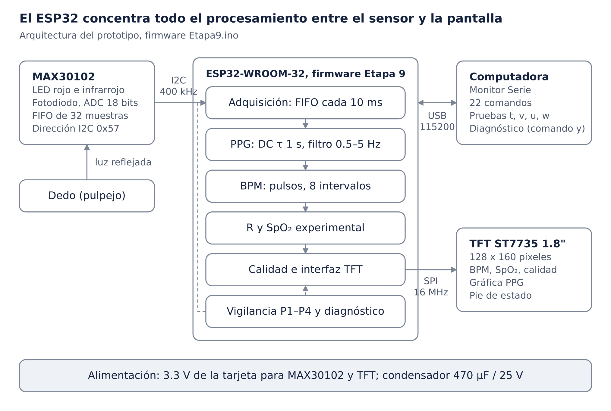

# Monitor experimental de frecuencia cardiaca, SpO₂ y señal PPG (ESP32 + MAX30102)

> **Prototipo académico y experimental. No es un dispositivo médico.** No está certificado, no sustituye a un monitor clínico y no debe usarse para diagnóstico ni para decisiones de salud. La SpO₂ es una **estimación experimental** basada en la relación R y una curva genérica, **sin calibración ni validación clínica**. Ante una situación médica, use equipo clínico apropiado y consulte a personal sanitario.

Prototipo que adquiere la señal fotopletismográfica (PPG) roja e infrarroja con un sensor MAX30102, estima la frecuencia cardiaca (BPM) y una SpO₂ experimental en un ESP32, evalúa la calidad de la señal y lo muestra todo en una pantalla TFT ST7735 de 1.8", junto con la onda PPG en tiempo real.

Proyecto de la materia **Sistemas de Información Hospitalaria**, Maestría en Ingeniería Clínica. Autor, institución y profesor: pendientes de registrar (F1).

## Objetivo académico

Construir y documentar, con trazabilidad completa, la cadena de un monitor de pulso (luz → señal → pulso → razón R → valor → estado de validez) y verificarla de forma experimental. El proyecto se centra en la adquisición, el procesamiento, la visualización y la validación experimental; no en la exactitud clínica.

## Estado real de validación

| Elemento | Estado | Evidencia |
| --- | --- | --- |
| Firmware de referencia | `Etapa9.ino`, MD5 `4d70eb1aef89be2d7ab61ec6d39b9f12`, 4112 líneas, 154 funciones | [firmware/](firmware/) |
| Etapas 1–3, 4.1, 6.2 y 7.1–7.3 | Validadas en hardware por el autor (algunas con observaciones) | [resultados](docs/pruebas/resultados-pruebas.md) |
| Etapas 5, 6.1 y 8.2 | Sin cifras de hardware propias (5 y 6.1 se validaron de forma indirecta dentro de la 6.2) | [inventario](docs/inventario-documental.md) |
| **Etapa 9 (versión actual)** | **Pendiente de ejecución en hardware** (pruebas H0–H13). P1–P4 solo se han probado en simulación | [tests/hardware](tests/hardware/) |
| Pruebas unitarias en PC (Categoría 1, 45 funciones) | Ejecutadas: 116 de 116 casos; cobertura de líneas y ramas 100 % (objetivo ≥ 85 %, no criterio de aprobación); mutación 16/16. **Simulación en PC** | [tests/unitarias](tests/unitarias/) |
| Pruebas de integración en PC (2a–2g, E1–E17) | Pendientes de ejecución | [tests/integracion](tests/integracion/) |
| Exactitud clínica de BPM y SpO₂ | No evaluada: no hay oxímetro de referencia | [limitaciones](docs/limitaciones-y-seguridad.md) |

**El proyecto no está completamente validado.**

## Características del prototipo

- Adquisición RED/IR del MAX30102 por I²C a 400 kHz: 400 muestras/s internas con promedio de 4 (≈ 100 muestras/s; 99.1 medidas en la Etapa 4.1), lectura del FIFO cada 10 ms con detección de desbordamiento.
- Procesamiento PPG: resta del DC (τ = 1 s), pasa-altas Butterworth de 2.º orden de 0.5 Hz y pasa-bajas de 2.º orden de 5 Hz, con reinicio y estabilización ante escalones.
- BPM con umbral adaptativo, prominencia, periodo refractario adaptativo y rechazo de intervalos (40–180 BPM, ±30 % de la mediana); estados SIN SEÑAL, ESTABILIZANDO y BPM VÁLIDO.
- R por latido (regresión RED–IR, con pico a pico y RMS como verificación), cinco criterios de calidad y SpO₂ experimental con la curva genérica de Maxim; estados SIN SEÑAL, ESTABILIZANDO, CALIDAD INSUFICIENTE, FUERA DE RANGO y VÁLIDA.
- Calidad de señal en cinco categorías (BUENA, REGULAR, MALA, SIN DEDO, BUSCANDO).
- Interfaz TFT de 128 × 160 con actualización parcial, gráfica PPG de barrido (≈ 5.1 s por pantalla), aviso inicial “NO ES DISPOSITIVO MEDICO” y pie “ESTIM. EXPERIMENTAL”.
- Robustez de la Etapa 9: P1 oculta los valores tras 1 s sin muestras, P2 reinicializa el sensor tras 3 s, P3 separa las pérdidas de arranque de las de operación y P4 mide tiempos con sumas de 64 bits.
- Monitor Serie a 115200 baudios con 22 comandos, cuatro pruebas guiadas (`t`, `v`, `u`, `w`) y diagnóstico de integración (`y`).
- **No incluye:** WiFi, Bluetooth, alarmas, microSD, registro de datos ni interoperabilidad.

## Hardware

| Componente | Modelo | Interfaz | Alimentación |
| --- | --- | --- | --- |
| Microcontrolador | ESP32-WROOM-32 (tarjeta de desarrollo) | USB, I²C, SPI | USB de la tarjeta (fuente por confirmar) |
| Sensor óptico | MAX30102 | I²C 0x57, 400 kHz | 3.3 V |
| Pantalla | TFT 1.8", ST7735S, `INITR_BLACKTAB` | SPI 16 MHz | 3.3 V |
| Condensador | Electrolítico 470 µF / 25 V | — | Punto de conexión por confirmar |

Conexiones: MAX30102 VIN→3.3 V, GND→GND, SDA→GPIO21, SCL→GPIO22, INT y RD sin conexión. TFT LED→3.3 V, SCK→GPIO18, SDA (MOSI)→GPIO23, A0/DC→GPIO16, RESET→GPIO17, CS→GPIO5, GND→GND, VCC→3.3 V. El SDA del MAX30102 es del bus I²C; el SDA de la TFT es MOSI del bus SPI. Detalle: [hardware/](hardware/).



## Instalar, compilar y cargar

1. Instale el IDE de Arduino y el núcleo **Arduino-ESP32 3.3.x** (Gestor de tarjetas → “esp32”, de Espressif).
2. Instale las librerías **SparkFun MAX3010x Pulse and Proximity Sensor Library**, **Adafruit ST7735 and ST7789 Library** y **Adafruit GFX Library** (con Adafruit BusIO).
3. Abra [`firmware/etapa9-validada/Etapa9/Etapa9.ino`](firmware/etapa9-validada/Etapa9/Etapa9.ino) y compruebe su MD5 (`4d70eb1aef89be2d7ab61ec6d39b9f12`).
4. Seleccione la placa ESP32 de su tarjeta y el puerto; compile y cargue.
5. Abra el Monitor Serie a 115200 baudios; `h` muestra la ayuda.

Las versiones exactas del núcleo, de las librerías y de la configuración de placa usadas en el prototipo están pendientes de registrar (F9). Detalle: [firmware/README.md](firmware/README.md).

Pruebas unitarias en PC (Linux o WSL): ver [tests/unitarias/README.md](tests/unitarias/README.md).

## Documentación

| Documento | Contenido |
| --- | --- |
| [Documentación técnica](docs/documentacion-tecnica.md) ([PDF](docs/pdf/documentacion-tecnica.pdf)) | 42 capítulos: fundamento, arquitectura, algoritmos, P1–P4, pruebas, resultados, limitaciones y anexos |
| [Manual de usuario](docs/manual-usuario.md) ([PDF](docs/pdf/manual-usuario.pdf)) | Uso del equipo para una persona que no conoce el código |
| [Presentación](docs/presentacion/presentacion-proyecto.pptx) y [guion oral](docs/presentacion/guion-oral.md) | 20 diapositivas con notas del expositor (≈ 14.5 min) |
| [Plan de pruebas – Etapa 10](docs/pruebas/plan-pruebas-etapa10.md) | Categorías 1, 2a–2g, H0–H13 y E1–E17 |
| [Resultados de pruebas](docs/pruebas/resultados-pruebas.md) | Separados en hardware, simulación en PC y pendientes |
| [Matriz de trazabilidad](docs/pruebas/matriz-trazabilidad.md) | Capacidad → código → origen → prueba → evidencia |
| [Inventario documental](docs/inventario-documental.md) | Fuentes, MD5, inconsistencias I1–I12 e información faltante F1–F14 |
| [Expediente de evidencias](docs/evidencias/README.md) | Índice de 42 evidencias y cómo registrar nuevas |
| [Limitaciones y seguridad](docs/limitaciones-y-seguridad.md) | Limitaciones técnicas y clínicas, seguridad de uso |
| [Diagramas](docs/diagramas/) | Arquitectura, conexiones, flujo del firmware, cadena de procesamiento y estados de pantalla (PNG y SVG) |

## Estructura del repositorio

```text
.
├── README.md
├── CHANGELOG.md
├── docs/
│   ├── documentacion-tecnica.md
│   ├── manual-usuario.md
│   ├── inventario-documental.md
│   ├── limitaciones-y-seguridad.md
│   ├── pdf/               documentacion-tecnica.pdf, manual-usuario.pdf
│   ├── presentacion/      presentacion-proyecto.pptx, guion-oral.md
│   ├── diagramas/         5 diagramas en PNG y SVG
│   ├── pruebas/           plan, resultados y matriz de trazabilidad
│   └── evidencias/        índice de evidencias y pantallas simuladas
├── firmware/
│   ├── etapa9-validada/   Etapa9/Etapa9.ino (línea base) y diffs
│   └── historial/         firmwares de las etapas 1 a 8.2
├── hardware/              componentes, conexiones y lista de materiales
└── tests/
    ├── unitarias/         Categoría 1 (ejecutada en PC)
    ├── integracion/       2a–2g y E1–E17 (pendiente de ejecución)
    └── hardware/          H0–H13 (pendiente de ejecución)
```

## Limitaciones y advertencias

- Prototipo académico y experimental; **no es un dispositivo médico certificado** y no sustituye a un monitor clínico.
- **La SpO₂ no tiene validación clínica**: coeficientes genéricos sin calibrar y sin comparación contra un oxímetro de referencia. La única prueba registrada dio ≈ 99.9 % en reposo, lo que sugiere sobreestimación.
- La exactitud clínica del BPM y de la SpO₂ **no se demostró**. Solo se probó con el dedo en reposo.
- Sin alarmas, sin registro y sin aislamiento de grado médico; no se evaluó frente a normas de seguridad de equipo electromédico.
- **No debe usarse para diagnóstico** ni para decisiones de salud.

Detalle: [docs/limitaciones-y-seguridad.md](docs/limitaciones-y-seguridad.md).

## Licencia

Este repositorio **no tiene licencia** por decisión del autor: todos los derechos reservados. Las librerías de terceros que usa el firmware (SparkFun, Adafruit, Espressif) conservan sus propias licencias y no se incluyen en el repositorio.
