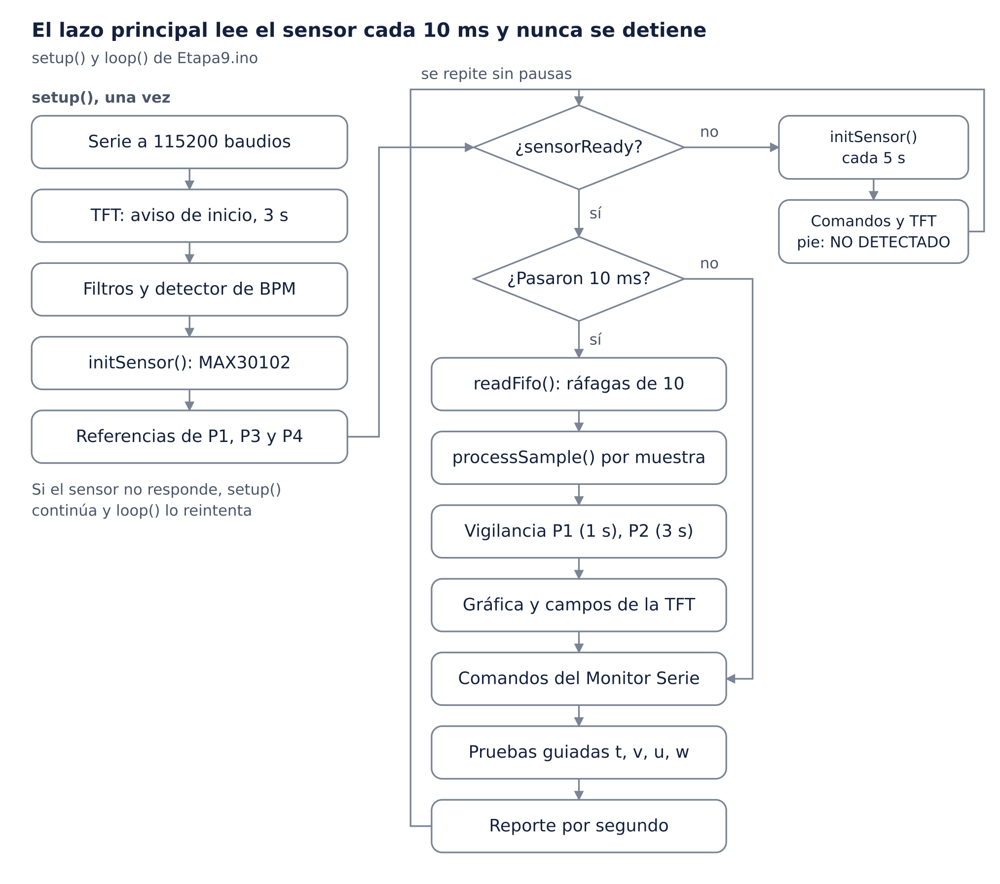
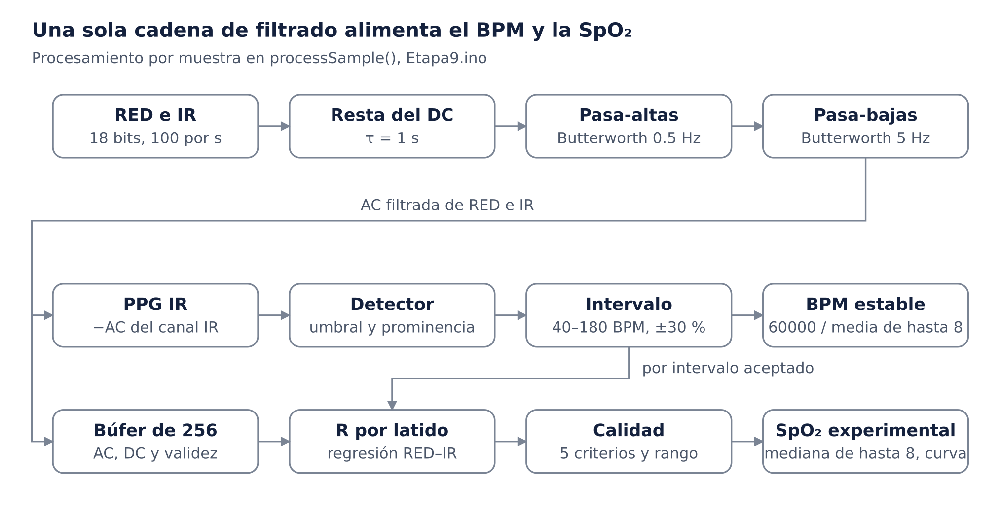

# Documentación técnica – Monitor experimental de FC y SpO₂ por PPG

> Versión documentada: `firmware/etapa9-validada/Etapa9/Etapa9.ino`, MD5 `4d70eb1aef89be2d7ab61ec6d39b9f12`. Exportado al repositorio el 2026-10-09.

Prototipo académico con ESP32, MAX30102 y TFT ST7735 que adquiere la señal PPG, estima la frecuencia cardíaca y una SpO₂ experimental, y las muestra en pantalla. **No es un dispositivo médico** y la SpO₂ no tiene validación clínica. Firmware documentado: `Etapa9.ino`, MD5 `4d70eb1aef89be2d7ab61ec6d39b9f12`; su validación en hardware está pendiente de ejecución.

## 1. Portada

| Campo | Dato |
| --- | --- |
| Título | Monitor experimental de frecuencia cardíaca y SpO₂ mediante señal PPG |
| Tipo de trabajo | Prototipo académico y experimental |
| Materia | Sistemas de Información Hospitalaria |
| Programa | Maestría en Ingeniería Clínica |
| Institución | \[pendiente: F1\] |
| Autor | \[pendiente: F1\] |
| Profesor | \[pendiente: F1\] |
| Fecha de entrega | \[pendiente: F1\] |
| Versión documentada | `Etapa9.ino`, MD5 `4d70eb1aef89be2d7ab61ec6d39b9f12`, 4112 líneas, 154 funciones |
| Estado de validación | Etapas 1–3, 4.1, 6.2 y 7.1–7.3 validadas en hardware por el autor; 5 y 6.1 validadas de forma indirecta dentro de la 6.2; 8.2 sin cifras de hardware archivadas; Etapa 9 pendiente de ejecución en hardware; Etapa 10: Categoría 1 ejecutada en PC |

> **Aviso.** Este equipo no es un dispositivo médico, no está certificado y no debe usarse para diagnóstico ni para decisiones de salud. El BPM, la razón R y la SpO₂ son estimaciones experimentales.

## 2. Resumen

Se desarrolló un prototipo que adquiere la señal de fotopletismografía (PPG) roja e infrarroja de un MAX30102 a unas 100 muestras/s. Con ella estima la frecuencia cardíaca (BPM) y una saturación periférica de oxígeno (SpO₂) experimental, y muestra ambos valores, una categoría de calidad y la onda PPG en una pantalla TFT ST7735 de 1.8". El firmware se construyó en etapas incrementales; la mayoría se validó en hardware antes de pasar a la siguiente (capítulo 34).

El procesamiento separa la componente continua (DC, τ = 1 s) y filtra la pulsante (AC) con un pasa-altas de 0.5 Hz y un pasa-bajas de 5 Hz en cascada, ambos Butterworth de 2.º orden. Detecta pulsos con umbral adaptativo, prominencia y periodo refractario, y calcula el BPM como 60000 dividido entre la media de hasta 8 intervalos aceptados. Para la SpO₂ obtiene la razón R por latido mediante regresión RED–IR, la filtra con cinco criterios de calidad y la convierte con una curva cuadrática genérica no calibrada.

En hardware, la adquisición alcanzó 99.1 muestras/s sin pérdidas (Etapa 4.1). La prueba de SpO₂ de la Etapa 6.2 dio 35 latidos válidos con R ≈ 0.375 y CV de R ≈ 4 %, pero su SpO₂ media de ≈ 99.9 % no se comparó con un oxímetro de referencia. La Etapa 9 agrega vigilancia de datos congelados, reinicialización del sensor y diagnóstico de arranque y de tiempos. Sus pruebas en hardware están pendientes de ejecución; en PC aprobaron las 116 pruebas unitarias de la Categoría 1, con 100 % de cobertura de líneas y ramas de las 45 funciones que cubre.

**Palabras clave:** fotopletismografía, frecuencia cardíaca, SpO₂, ESP32, MAX30102, procesamiento digital de señales, prototipo experimental.

## 3. Abstract

An experimental prototype was built that acquires red and infrared photoplethysmography (PPG) signals from a MAX30102 sensor at about 100 samples/s. It estimates heart rate (BPM) and an experimental peripheral oxygen saturation (SpO₂), and shows both values, a signal-quality category and the PPG waveform on a 1.8" ST7735 TFT display. The firmware was developed in incremental stages, each validated before the next one.

The processing chain separates the DC component (τ = 1 s) and filters the pulsatile AC component with cascaded second-order Butterworth high-pass (0.5 Hz) and low-pass (5 Hz) filters. Pulses are detected with an adaptive threshold, prominence and a refractory period. BPM is 60000 divided by the mean of up to 8 accepted intervals. For SpO₂, a per-beat ratio R is estimated by RED–IR regression, screened with five quality criteria and converted with a generic, uncalibrated quadratic curve.

On hardware, acquisition reached 99.1 samples/s with no lost samples (stage 4.1). The stage 6.2 SpO₂ test produced 35 valid beats with R ≈ 0.375 and an R coefficient of variation of about 4 %; its mean SpO₂ of about 99.9 % was not compared against a reference oximeter. Stage 9 adds frozen-data detection, sensor re-initialization, and start-up and timing diagnostics. Its hardware tests are pending; on PC, all 116 unit tests of category 1 passed, with 100 % line and branch coverage of the 45 functions it covers. **This device is not a medical device.**

**Keywords:** photoplethysmography, heart rate, SpO₂, ESP32, MAX30102, digital signal processing, experimental prototype.

## 4. Introducción

La frecuencia cardíaca y la SpO₂ son dos de los signos que más se registran en un hospital, y la mayoría de los monitores los obtienen de una misma señal óptica: la fotopletismografía. Este proyecto reproduce, con componentes de bajo costo, la cadena completa de un monitor de ese tipo. Abarca la adquisición óptica, el procesamiento digital, la estimación de los parámetros, la evaluación de la calidad y la presentación en pantalla.

El prototipo usa un ESP32-WROOM-32, un sensor óptico MAX30102 y una pantalla TFT ST7735 de 128×160 píxeles. El firmware se escribió en Arduino/C++ en etapas: la 1 verificó la tarjeta; la 2 y la 2.1, el bus I2C; la 3, la lectura del FIFO; la 4.1, la señal PPG; la 5, el BPM; la 6.1 y la 6.2, la razón R y la SpO₂; la 7.1 a la 7.3, la pantalla; la 8.2, la gráfica PPG; y la 9, la robustez. La regla de trabajo fue no modificar ninguna lógica ya validada al agregar la siguiente.

Este documento describe el sistema tal como está en `Etapa9.ino` y lo liga, mediante números de línea (Lxxx), al código que lo implementa. Los resultados se separan en tres grupos: obtenidos en el hardware real, obtenidos en simulación en PC y pendientes de ejecución.

## 5. Planteamiento del problema

Un oxímetro de pulso comercial es una caja cerrada: entrega un número, pero no deja ver cómo se obtuvo ni cuándo deja de ser confiable. Para un ingeniero clínico, entender esa cadena es la base para evaluar equipos, interpretar alarmas y reconocer artefactos. El problema que aborda el proyecto tiene cuatro partes:

1. Obtener del MAX30102 una señal PPG continua, sin pérdidas de muestras y con una frecuencia de muestreo conocida.
2. Extraer de esa señal un BPM y una SpO₂ que solo se muestren cuando la señal es suficientemente buena, y que se oculten en lugar de mostrar un valor dudoso.
3. Presentarlos en una pantalla pequeña sin interrumpir la adquisición: el FIFO del sensor solo guarda unos 320 ms de datos.
4. Detectar fallas del sensor (datos congelados, sensor que deja de responder) y recuperarse sin reiniciar el microcontrolador.

## 6. Justificación

El proyecto tiene valor formativo para la ingeniería clínica porque hace visibles los pasos que un monitor comercial oculta:

- cómo la componente DC y la AC dependen del tejido y de la corriente del LED;
- por qué un pulso puede rechazarse;
- por qué la SpO₂ necesita varios latidos estables antes de mostrarse;
- qué tan sensible es al movimiento.

Dentro de la materia de Sistemas de Información Hospitalaria, el prototipo representa el primer eslabón de la cadena de información clínica: el dispositivo que genera el dato. En él se tratan la calidad del dato, su estado de validez (válido, estabilizando, sin señal) y la trazabilidad de su origen; sin esas propiedades, ningún sistema posterior puede confiar en el registro.

La versión actual **no** envía datos a ningún sistema: no tiene WiFi, Bluetooth, registro ni interoperabilidad (cabecera, L116). Esa integración queda como trabajo futuro.

La elección de componentes de bajo costo y del entorno Arduino permite repetir el prototipo con fines docentes. El enfoque por etapas, con pruebas automatizadas y MD5 de cada versión, aplica a un proyecto de software embebido las prácticas de control de versiones y verificación propias de la ingeniería de dispositivos.

## 7. Objetivo general

Diseñar, implementar y verificar de forma experimental un prototipo que adquiera la señal PPG roja e infrarroja de un MAX30102, estime la frecuencia cardíaca y una SpO₂ experimental, evalúe la calidad de la señal y lo presente todo en una pantalla TFT junto con la onda PPG en tiempo real. El prototipo debe ocultar los valores cuando la señal o el sensor no sean confiables.

## 8. Objetivos específicos

| N.º | Objetivo | Etapa | Estado de verificación |
| --- | --- | --- | --- |
| 1 | Establecer comunicación I2C estable con el MAX30102 a 400 kHz | 2, 2.1 | Validado en hardware (sin cifras archivadas) |
| 2 | Adquirir RED e IR del FIFO a ≈ 100 muestras/s sin pérdidas | 3, 4.1 | Validado en hardware: 99.1 muestras/s, 0 pérdidas |
| 3 | Separar DC y AC y filtrar la PPG entre 0.5 y 5 Hz | 4.1 | Validado en hardware (11 criterios de la prueba `t`) |
| 4 | Detectar pulsos y calcular un BPM estable con estados de validez | 5 | Inferido de la 6.2 validada; prueba H5 pendiente de ejecución |
| 5 | Calcular la razón R por latido con criterios de calidad | 6.1 | Validado dentro de la 6.2: R ≈ 0.375, CV ≈ 4 % |
| 6 | Estimar una SpO₂ experimental con estados de validez | 6.2 | Validado en hardware solo contra criterios internos; sin referencia clínica |
| 7 | Mostrar BPM, SpO₂ y calidad en la TFT sin interrumpir la adquisición | 7.1–7.3 | Validado en hardware: peor caso de dibujo ≈ 18.30 ms |
| 8 | Mostrar la onda PPG en tiempo real | 8.2 | Sin cifras de hardware; H8 y H9 pendientes de ejecución |
| 9 | Detectar datos congelados y recuperar el sensor sin reiniciar el ESP32 | 9 (P1, P2) | Solo simulación; H10 pendiente de ejecución |
| 10 | Registrar el arranque y los tiempos del sistema | 9 (P3, P4) | Solo simulación; H11 y H12 pendientes de ejecución |
| 11 | Verificar el firmware con pruebas unitarias, de integración y de hardware sin modificarlo | 10 | Categoría 1 ejecutada (116 de 116, PC); el resto pendiente de ejecución |

## 9. Alcance

**Incluye:**

- adquisición RED/IR del MAX30102 por I2C;
- procesamiento PPG, detección de pulsos y BPM;
- cálculo de R por latido, filtro de calidad y SpO₂ experimental;
- tabla de calidad de cinco categorías;
- interfaz TFT con valores, calidad, pie de estado y gráfica PPG;
- interfaz por Monitor Serie con 22 comandos, cuatro pruebas guiadas y diagnóstico de integración;
- vigilancia y recuperación del sensor (P1–P4);
- plan de pruebas de la Etapa 10 y pruebas unitarias de la Categoría 1.

**No incluye**, porque no existe en el firmware (L116 y revisión completa del código):

- WiFi, Bluetooth, registro en memoria o microSD;
- alarmas;
- interoperabilidad (HL7, FHIR u otra);
- uso del pin INT del sensor;
- control automático de la corriente de LED;
- calibración de la curva R→SpO₂.

Tampoco incluye validación clínica, comparación formal contra un oxímetro de referencia ni evaluación normativa.

## 10. Limitaciones

Las limitaciones principales son tres. Se detallan en los capítulos 36 y 37.

1. **Es un prototipo académico.** No es un dispositivo médico certificado, no sustituye a un monitor clínico y no debe usarse para diagnóstico.
2. **La SpO₂ no tiene validación clínica.** Los coeficientes de la curva son genéricos, sin calibrar para este módulo, y no se compararon contra un oxímetro de referencia. La exactitud clínica no se demostró.
3. **La Etapa 9 no está validada en hardware.** Las pruebas físicas H0–H13 y las de integración en PC (2a–2g, E1–E17) están pendientes de ejecución.

El proyecto se centra en la adquisición, el procesamiento, la visualización y la validación experimental del sistema, no en la exactitud clínica.

## 11. Fundamento teórico

### 11.1 Frecuencia cardíaca

La frecuencia cardíaca (FC) es el número de ciclos cardíacos por unidad de tiempo. Cada sístole envía una onda de presión y de volumen por el árbol arterial que llega a los tejidos periféricos, como el pulpejo del dedo, con un retraso respecto al ECG. Un monitor óptico no mide la actividad eléctrica del corazón: mide ese pulso periférico. Por eso cuenta “pulsos”, y una contracción que no genera onda periférica no se detecta.

### 11.2 BPM

La FC se expresa en latidos por minuto (BPM). Si el intervalo entre dos pulsos consecutivos es *I* en milisegundos, el BPM instantáneo es 60000 / *I*. El firmware no muestra el BPM instantáneo: muestra un **BPM estable**, calculado con la media de hasta 8 intervalos aceptados (`hrStableBpm`, L1242–1245).

```math
\mathrm{BPM} = \frac{60000}{\bar{I}}, \qquad \bar{I} = \frac{1}{n}\sum_{k=1}^{n} I_k, \quad n \le 8
```

El intervalo se mide en muestras y se convierte a milisegundos con la frecuencia de muestreo **medida** (`measuredFs`, L1404). Un error de 0.9 % en fs daría un error de 0.9 % en el BPM, como advierte el comentario de L1144.

### 11.3 Fotopletismografía (PPG)

La PPG mide, con una fuente de luz y un fotodetector, los cambios de absorción óptica de un tejido vascularizado. La luz que llega al detector tiene dos partes:

- una casi constante, la **componente DC**, que corresponde al tejido, al hueso, a la sangre venosa y a la parte no pulsante de la arterial;
- otra que oscila con cada latido, la **componente AC**, que se debe al aumento de volumen arterial en la sístole.

En sangre, a mayor volumen hay mayor absorción y por lo tanto menos luz recibida. Por eso la señal cruda tiene sus mínimos en la sístole. El firmware invierte la componente AC (PPG = −AC, L79) para que el pico sistólico quede hacia arriba, como se acostumbra en los monitores.

### 11.4 Principio óptico del MAX30102

El MAX30102 (Maxim Integrated, hoy Analog Devices) integra en un módulo:

- dos LED, uno rojo de ≈ 660 nm y uno infrarrojo de ≈ 880 nm;
- un fotodiodo con cancelación de luz ambiental;
- un convertidor analógico-digital de hasta 18 bits;
- un FIFO de 32 muestras;
- una interfaz I2C con dirección 0x57.

El sensor funciona en reflexión: los LED y el fotodiodo están del mismo lado y el dedo se apoya encima. En modo SpO₂ enciende los dos LED por turnos y guarda cada pareja RED/IR como una muestra. El firmware verifica el PART\_ID 0x15 al iniciar (`EXPECTED_PART_ID`, L163; `initSensor`, L519–522).

### 11.5 Señales RED e IR

La hemoglobina oxigenada (HbO₂) y la desoxigenada (Hb) absorben distinto. En el rojo (≈ 660 nm) la Hb absorbe mucho más que la HbO₂; en el infrarrojo (≈ 880–940 nm) la HbO₂ absorbe algo más que la Hb. Al comparar la parte pulsante de las dos longitudes de onda se obtiene una medida relacionada con la proporción de HbO₂ en la sangre arterial.

En el prototipo, el canal IR tuvo mayor AC que el rojo: en la Etapa 4.1 se midió un AC pico a pico medio de 830.0 cuentas en IR y de 293.4 en RED. Por eso el IR es la señal que se usa para detectar pulsos y para la gráfica, mientras que la pareja RED/IR se usa para R.

### 11.6 Componentes AC y DC

La componente DC se estima con un filtro exponencial de primer orden con constante de tiempo τ = 1 s (`DC_TIME_CONSTANT_S`, L206; `computeFilterCoefficients`, L546–549):

```math
DC[n] = DC[n-1] + \alpha\,\bigl(x[n] - DC[n-1]\bigr), \qquad \alpha = 1 - e^{-1/(f_s\,\tau)} \approx 0.00995
```

La componente AC es la señal menos su DC, filtrada luego en banda. El cociente AC/DC se llama índice de perfusión (PI). El firmware lo calcula pico a pico y en porcentaje para cada latido (L2041–2042), y exige un PI IR ≥ 0.20 % para aceptar el latido en la SpO₂ (`SP_MIN_PI_IR`, L1831).

### 11.7 Relación R

La razón de razones R compara la pulsatilidad relativa del rojo con la del infrarrojo. Al dividir cada AC entre su DC se elimina, en primera aproximación, el efecto de la intensidad del LED y del espesor del tejido:

```math
R = \frac{AC_{RED}/DC_{RED}}{AC_{IR}/DC_{IR}}
```

El firmware calcula R de tres maneras para cada latido (`spo2OnBeat`, L1980–2056):

| Estimador | Qué usa como “AC” | Uso en el firmware | Línea |
| --- | --- | --- | --- |
| R de regresión (principal) | Pendiente de AC\_RED frente a AC\_IR en todo el latido | Es el que entra al historial y a la SpO₂ | L2024–2025 |
| R pico a pico (R\_pp) | Máximo − mínimo de cada canal | Verificación cruzada | L2018 |
| R RMS (R\_rms) | Desviación estándar de cada canal | Verificación cruzada | L2019 |

```math
R_{reg} = \frac{\operatorname{cov}(AC_{RED}, AC_{IR})}{\operatorname{var}(AC_{IR})} \cdot \frac{DC_{IR}}{DC_{RED}}
```

La regresión usa todas las muestras del latido y no solo dos extremos, por lo que es menos sensible al ruido. El comentario de L1813–1815 cita una simulación en PC donde R\_pp se sesgó hasta +17 % y R\_rms hasta +10 % con ruido, mientras que la regresión se mantuvo dentro de ±1 %. Es un resultado de simulación, no de hardware.

### 11.8 Estimación de SpO₂

La SpO₂ es el porcentaje de hemoglobina arterial que está oxigenada. Un oxímetro de pulso no la mide directamente: calcula R y la convierte con una curva de calibración obtenida empíricamente, con voluntarios cuya saturación se mide en sangre arterial. El firmware usa la curva cuadrática genérica del algoritmo de referencia de Maxim incluido en la librería SparkFun (`oxSpo2FromR`, L2361–2363; coeficientes en L2271–2273):

```math
SpO_2\,[\%] = -45.060\,R^2 + 30.354\,R + 94.845
```

> **Los coeficientes son genéricos y experimentales.** No están calibrados para este módulo, esta corriente de LED ni este tejido (comentario L2261–2265: “NO están calibrados para este módulo”). La SpO₂ resultante **no es una medición clínica validada**.

El vértice de la parábola está en R ≈ 0.337 (SpO₂ ≈ 99.96 %). Por eso el firmware solo acepta R entre 0.34 y 1.15 (`SP_R_MIN_USEFUL`, `SP_R_MAX_USEFUL`, L1836–1837), el tramo en que la curva es monótona. En ese tramo la curva va de 99.96 % a 70.16 %; estos valores se comprobaron en la Categoría 1 contra un cálculo independiente en Python.

### 11.9 Filtrado digital

La banda útil de la PPG está entre 0.5 Hz (30 BPM) y unos 5 Hz, porque la fundamental y los primeros armónicos del pulso en reposo caen por debajo de esa frecuencia. El firmware aplica, en cascada y por canal:

- un **pasa-altas** Butterworth de 2.º orden de 0.5 Hz, que atenúa la deriva lenta y la respiración;
- un **pasa-bajas** Butterworth de 2.º orden de 5 Hz, que quita el ruido y el parpadeo de alta frecuencia.

Cada filtro es un biquad IIR (Q = 1/√2) diseñado por transformación bilineal según el *Audio EQ Cookbook*, implementado en forma directa II transpuesta (`highPass`, L593–598; `lowPass`, L601–606):

```math
y[n] = b_0 x[n] + b_1 x[n-1] + b_2 x[n-2] - a_1 y[n-1] - a_2 y[n-2]
```

Los coeficientes se calculan con la frecuencia nominal de 100 Hz. En la Categoría 1 los coeficientes coincidieron con `scipy.signal.butter` (error absoluto ≤ 1e-5); la respuesta a un escalón y a un seno de 1.2 Hz coincidió con `scipy.signal.lfilter` (error relativo ≤ 1e-4), y la ganancia en cada frecuencia de corte quedó en −3.01 dB (tolerancia ±0.1 dB).

### 11.10 Detección de pulsos

Detectar un pulso es encontrar el pico sistólico de cada ciclo sin confundirlo con la muesca dicrótica, con el ruido ni con un artefacto. Las técnicas que usa el firmware son estándar en monitorización:

- **umbral adaptativo:** una envolvente que sigue la amplitud de la señal;
- **prominencia:** cuánto sube el pico desde el valle de su propio ciclo;
- **periodo refractario:** el tiempo mínimo antes del siguiente pulso;
- **interpolación parabólica:** sitúa el pico entre muestras con resolución menor a 10 ms;
- **consistencia temporal:** rechaza los intervalos que se desvían mucho de la mediana reciente.

El capítulo 21 describe los valores concretos.

## 12. Arquitectura general del sistema

El sistema tiene tres módulos de hardware: el sensor MAX30102, el ESP32 y la pantalla TFT. Una computadora se conecta por USB solo para enviar comandos y leer diagnósticos; no participa en la medición. Dentro del ESP32, el firmware encadena seis bloques: adquisición, procesamiento PPG, BPM, R y SpO₂, calidad e interfaz, y vigilancia.


La cadena va de arriba abajo. El bloque de vigilancia, en línea discontinua, no forma parte de la cadena: observa la llegada de muestras, oculta los valores en la pantalla (P1) y puede pedir la reinicialización del sensor (P2).

## 13. Arquitectura electrónica

El ESP32 es el único controlador. Se comunica con el MAX30102 por I2C (2 hilos) y con la pantalla por SPI (4 señales más RESET). Los dos módulos se alimentan del regulador de 3.3 V de la tarjeta, de modo que todos los niveles lógicos son de 3.3 V y no hacen falta convertidores de nivel. Los dos buses son independientes y no comparten pines.

> **Aclaración sobre “SDA”.** El pin SDA del MAX30102 es la línea de datos del bus **I²C** y va a GPIO21. El pin rotulado “SDA” en la TFT es en realidad **MOSI** del bus **SPI** y va a GPIO23. Son señales distintas que comparten nombre en la serigrafía.

No se usan el pin INT ni el RD del MAX30102: la adquisición es por sondeo cada 10 ms (L38, L189). Tampoco se usan MISO ni la microSD de la TFT (L41, L2821). El firmware reserva GPIO19 como MISO en `SPI.begin` (L3199), pero no se conecta.

## 14. Componentes de hardware

| Componente | Modelo | Función | Interfaz | Alimentación |
| --- | --- | --- | --- | --- |
| Microcontrolador | ESP32-WROOM-32 en tarjeta de desarrollo (la cabecera del firmware la nombra “NodeMCU ESP-32S”; confirmar: I10) | Adquisición, procesamiento, interfaz y Monitor Serie | USB-serie a 115200 baudios; I2C; SPI | USB de la tarjeta \[pendiente de confirmar: F3\] |
| Sensor óptico | MAX30102 (módulo; LED rojo e IR, fotodiodo, ADC de 18 bits, FIFO de 32) | Señales PPG RED e IR | I2C, dirección 0x57, 400 kHz | 3.3 V desde el ESP32 (VIN) |
| Pantalla | TFT “1.8 TFT SPI 128\*160 V1.1.1”, controlador ST7735S, variante `INITR_BLACKTAB` | BPM, SpO₂, calidad, pie y gráfica PPG | SPI por hardware (VSPI), 16 MHz | 3.3 V (VCC y LED de retroiluminación) |
| Condensador | Electrolítico 470 µF / 25 V | Reserva de carga en la alimentación | — | Ubicación en el circuito \[pendiente: F3\] |

No consta que el prototipo incluya el condensador de 100 nF que mencionan los archivos del enfoque inicial; NeoPixel, WiFi y servidor no forman parte del prototipo. Ver la inconsistencia I9 del inventario.

## 15. Tabla completa de conexiones

| ESP32 GPIO | Dispositivo | Pin | Función | Constante en el firmware |
| --- | --- | --- | --- | --- |
| 3.3 V | MAX30102 | VIN | Alimentación del sensor | — |
| GND | MAX30102 | GND | Tierra | — |
| GPIO21 | MAX30102 | SDA | Datos I²C | `PIN_SDA` = 21 (L154) |
| GPIO22 | MAX30102 | SCL | Reloj I²C, 400 kHz | `PIN_SCL` = 22 (L155), `I2C_FREQ` (L156) |
| — | MAX30102 | INT | Sin conexión | — |
| — | MAX30102 | RD | Sin conexión | — |
| 3.3 V | TFT | VCC | Alimentación de la pantalla | — |
| GND | TFT | GND | Tierra | — |
| 3.3 V | TFT | LED | Retroiluminación | — |
| GPIO18 | TFT | SCK | Reloj SPI | `TFT_SCK` = 18 (L2819) |
| GPIO23 | TFT | SDA (MOSI) | Datos SPI hacia la pantalla | `TFT_MOSI` = 23 (L2820) |
| GPIO16 | TFT | A0 (DC) | Selección dato o comando | `TFT_DC` = 16 (L2822) |
| GPIO17 | TFT | RESET | Reinicio de la pantalla | `TFT_RST` = 17 (L2823) |
| GPIO5 | TFT | CS | Selección de chip | `TFT_CS` = 5 (L2824) |
| GPIO19 | — | (MISO) | Reservado por `SPI.begin`; no se conecta | `TFT_MISO_UNUSED` = 19 (L2821) |


La cabecera del firmware repite estas conexiones (L35–41). Coinciden con las que el autor declaró para el prototipo.

## 16. Alimentación eléctrica

Todo el sistema funciona a 3.3 V. El MAX30102 (VIN) y la TFT (VCC y LED) se alimentan del pin de 3.3 V de la tarjeta del ESP32, cuyo regulador se alimenta a su vez por el conector USB. El USB es también la vía del Monitor Serie con el que se envían los comandos y se leen los resultados. La fuente concreta (puerto de computadora, cargador u otra) no está documentada \[pendiente: F3\].

El prototipo incluye un condensador electrolítico de 470 µF / 25 V. Su función habitual en un montaje así es servir de reserva de carga frente a los picos de corriente de los LED y de la retroiluminación. Los archivos del enfoque inicial lo ubicaban en el riel de 3.3 V, pero el nodo real no está documentado \[pendiente: F3\]. Su tensión nominal de 25 V supera con amplio margen la del circuito.

El firmware no mide la tensión de alimentación. Lo que sí hace es informar el motivo del último reinicio, incluido “CAIDA DE VOLTAJE (brownout)” (`resetReasonText`, L3612–3624, salida de `y`). La prueba H12 (60 min, motivo de reinicio = encendido) está pendiente de ejecución.

La corriente de los LED del sensor es de 6.2 mA por defecto (0x1F × 0.2 mA, L173). Se puede variar a mano con `+` y `-` en pasos de 1 mA, entre 1.2 y 15.2 mA (inconsistencia I2).

## 17. Arquitectura de software

El firmware es un solo archivo, `Etapa9.ino`, con 154 funciones agrupadas en módulos que corresponden a las etapas del desarrollo. Todo corre en el lazo principal, sin tareas de FreeRTOS, sin interrupciones propias y sin `delay()` durante la medición. Los únicos retardos son dos de `setup()`: 1 s tras abrir el puerto serie (L4032) y 3 s de pantalla de inicio (L3216).

**Entorno.** Arduino IDE con el núcleo Arduino-ESP32 3.3.x (ESP-IDF 5.5), según la cabecera (L24). Librerías:

- SparkFun MAX3010x Pulse and Proximity Sensor Library (`MAX30105.h`, compatible con el MAX30102), más `Wire`;
- Adafruit ST7735 and ST7789 Library;
- Adafruit GFX (con BusIO).

Las versiones exactas no están documentadas \[pendiente: F9\]. De la librería SparkFun solo se usan la inicialización y la configuración del sensor. **No** se usan sus algoritmos de pulso (`heartRate.h`) ni de SpO₂ (`spo2_algorithm.h`): el FIFO se lee directamente por `Wire` y el procesamiento es propio.

| Módulo | Líneas | Funciones principales | Etapa de origen |
| --- | --- | --- | --- |
| Sensor MAX30102 | L459–538 | `readRegisters`, `initSensor`, `setLedCurrent`, `printConfiguration` | 2, 3 |
| Filtros y PPG | L546–713 | `computeFilterCoefficients`, `highPass`, `lowPass`, `processPPG`, `isLargeStep` | 4.1 |
| Estadísticas por segundo | L720–827 | `correlationFromSums`, `accumulateWindow`, `reportWindow` | 4.1 |
| Prueba guiada de señal (`t`) | L832–1135 | `startPpgTest`, `updatePpgTest`, `finishPpgTest` | 4.1 |
| Frecuencia de muestreo medida | L1137–1157 | `updateFsMeasurement` | 5 |
| Detector de pulsos y BPM | L1162–1564 | `updateHeartRate`, `hrEvaluateInterval`, `hrUpdateState`, `hrCommitPulse` | 5 |
| Prueba guiada de BPM (`v`) | L1569–1799 | `startBpmTest`, `finishBpmTest` | 5 |
| R por latido | L1828–2076 | `spo2StoreSample`, `spo2OnBeat` | 6.1 |
| Prueba guiada de R (`u`) | L2081–2247 | `startRTest`, `finishRTest` | 6.1 |
| SpO₂ experimental | L2261–2511 | `oxOnBeat`, `oxUpdateState`, `oxSpo2FromR` | 6.2 |
| Prueba guiada de SpO₂ (`w`) | L2516–2717 | `startSpo2Test`, `finishSpo2Test` | 6.2 |
| Tubería por muestra y FIFO | L2722–2809 | `processSample`, `readFifo` | 3 a 6.2 |
| Interfaz TFT | L2819–3253 | `uiInit`, `uiDibujarCampo`, `uiSolicitar`, `uiService` | 7.1–7.3 |
| Gráfica PPG | L3257–3528 | `uiPpgConsumirMuestras`, `uiPpgDibujarColumna`, `uiPpgActualizarEscala` | 8.2 |
| Calidad y publicación a la TFT | L3539–3571 | `calidadDesdeEstados`, `uiActualizarDesdeEstados` | 7.3 |
| Robustez y diagnóstico (P1–P4) | L3574–3873 | `vigilanciaMuestras`, `arranqueRegistrarInit`, `tramoReiniciar`, `printIntegracion` | 9 |
| Comandos del Monitor Serie | L3878–4024 | `handleSerialCommands`, `setOutputMode`, `printHelp` | todas |
| Inicio y lazo principal | L4029–4112 | `setup`, `loop` | todas |

**Reglas de diseño aplicadas:**

1. **La interfaz solo lee estados.** Lee `hrState`, `hrStableBpm()`, `oxState`, `oxSpo2`, `lastDc[CH_IR]` y `sensorReady` (L60–70) y no agrega criterios de calidad propios (L3539–3541).
2. **La gráfica no adquiere datos.** Consume el búfer que ya existe para R (`spAcIr`, `spOk`), a través de un único adaptador (`ppgMuestra`, L3460–3469).
3. **La Etapa 9 no toca los algoritmos.** Solo lee contadores, y para recuperar el sensor se limita a poner `sensorReady = false`; desde ahí actúa la ruta de reintento que ya existía (L3628–3631).
4. **Las firmas usan tipos básicos.** Así se evitan los problemas con los prototipos automáticos del IDE de Arduino, que el autor ya había encontrado en etapas anteriores.
5. **Ninguna etapa** debe modificar la lógica validada de la anterior. Desde la Etapa 7.3, cada etapa parte de una copia de la versión validada y se verifica con un diff (archivos Etapa7\_3\_vs\_Etapa6\_2.diff, Etapa8\_2\_vs\_Etapa7\_3.diff y Etapa9\_vs\_Etapa8\_2.diff) y con el MD5.

## 18. Flujo general del firmware

`setup()` se ejecuta una vez (L4029–4069) y `loop()` se repite sin pausas (L4071–4112). En cada vuelta del lazo hay dos decisiones: si el sensor está listo y si ya pasaron 10 ms desde la última lectura del FIFO.



Con el sensor listo, cada 10 ms se vacía el FIFO y cada muestra recorre toda la cadena de procesamiento. Después se revisan la vigilancia, la gráfica y la pantalla, y en todas las vueltas se atienden los comandos, las pruebas guiadas y el reporte por segundo. Si el sensor no está listo, el lazo solo reintenta `initSensor()` cada 5 s, atiende comandos y muestra “SENSOR NO DETECTADO”; las pruebas y el reporte por segundo no se ejecutan.

## 19. Adquisición de datos del MAX30102

El sensor muestrea internamente a 400 muestras/s y promedia de 4 en 4, así que entrega 100 muestras/s nominales. En hardware se midieron 99.1 muestras/s (Etapa 4.1). El ESP32 vacía el FIFO cada 10 ms. La configuración es idéntica a la de la Etapa 3 validada (L72–73).

| Parámetro | Valor | Constante (línea) | Tipo de dato |
| --- | --- | --- | --- |
| Frecuencia de muestreo interna | 400 muestras/s | `SAMPLE_RATE_INTERNAL` (L179) | Decisión de diseño (Etapa 3) |
| Promedio en el FIFO | 4 muestras | `SAMPLE_AVERAGE` (L177) | Decisión de diseño (Etapa 3) |
| Frecuencia efectiva nominal | 100 muestras/s | `FS_NOMINAL` = 400 / 4 (L182) | Decisión de diseño |
| Frecuencia efectiva medida | 99.1 muestras/s | Comentario L1140–1141; `measuredFs` | **Resultado medido** (Etapas 4.1 y 6.2) |
| Profundidad del FIFO | 32 muestras (≈ 320 ms a 100 muestras/s) | `FIFO_DEPTH` (L190) | Dato del sensor |
| Capacidad del FIFO informada en la 7.3 | ≈ 321 ms | Salida de `y` (32 · 1000 / fs medida, L3748) | **Resultado medido** (calculado con la fs medida) |
| Frecuencia I²C | 400 kHz | `I2C_FREQ` (L156), en `Wire.begin` (L511) | Decisión de diseño (Etapa 2.1: estable a 100 y 400 kHz) |
| Tiempo límite de I²C | 50 ms | `I2C_TIMEOUT_MS` (L157) | Decisión de diseño |
| Ancho de pulso del LED | 411 µs | `PULSE_WIDTH_US` (L180) | Decisión de diseño |
| Resolución del ADC | 18 bits (0–262143) | `ADC_MAX_COUNTS` (L195); máscara `& 0x3FFFF` (L2801–2802) | Consecuencia del ancho de pulso de 411 µs |
| Rango del ADC | 4096 nA | `ADC_RANGE_NA` (L181) | Decisión de diseño |
| Corriente de LED (RED e IR) | 0x1F = 6.2 mA | `LED_CURRENT_DEFAULT` (L173) | Decisión de diseño; ajustable con `+`/`-` |
| Modo | RED + IR (modo SpO₂ del sensor) | `LED_MODE` = 2 (L178) | Decisión de diseño |
| Registros esperados | FIFO\_CONFIG 0x50, MODE\_CONFIG 0x03, SPO2\_CONFIG 0x2F | L184–186; verificados con `i` (L478–506) | Comprobación de configuración |
| Sondeo del FIFO | cada 10 ms | `POLL_INTERVAL_MS` (L189) | Decisión de diseño |
| Tamaño de ráfaga | hasta 10 muestras (60 bytes) | `MAX_SAMPLES_PER_READ` (L192) | Decisión de diseño |
| Umbral de saturación | 260000 cuentas | `SATURATION_LEVEL` (L196) | Decisión de diseño |
| Umbral de dedo presente | DC IR ≥ 50000 cuentas | `FINGER_IR_THRESHOLD` (L197, “heurística”) | Decisión de diseño |

**Por qué se eligieron.** Con 100 muestras/s hay 10 ms entre muestras: margen suficiente para un pulso de hasta 180 BPM (intervalo de 333 ms) y para la interpolación parabólica del pico. Promediar 4 muestras internas reduce el ruido sin perder banda, porque la PPG útil no pasa de 5 Hz. El ancho de pulso de 411 µs da la máxima resolución del ADC (18 bits). Leer cada 10 ms deja el FIFO casi vacío, con 1 muestra pendiente por lectura de media. Así el sistema tolera bloqueos de hasta ≈ 320 ms, por ejemplo el redibujado de la pantalla, sin perder datos. La corriente de 6.2 mA es una corriente “moderada” (L528) que produjo DC IR con dedo por encima del umbral y sin saturación en la Etapa 4.1 (0 saturaciones).

**Estrategia de lectura del FIFO** (`readFifo`, L2771–2809):

1. Lee WR\_PTR, OVF\_COUNTER y RD\_PTR (registros 0x04–0x06) en una sola transacción.
2. Calcula las muestras pendientes como (WR\_PTR − RD\_PTR) módulo 32.
3. Lee los datos en ráfagas de hasta 10 muestras desde el registro 0x07. Cada muestra son 6 bytes, primero RED y después IR, con 3 bytes cada uno en orden *big-endian*.
4. Pasa cada muestra a `processSample()`, que ejecuta toda la cadena de procesamiento.

**Desbordamiento (overflow).** Si OVF\_COUNTER es mayor que 0, el FIFO se llenó y se perdieron muestras. El firmware hace tres cosas:

- suma 1 a `overflowEvents`;
- suma el valor de OVF a `lostSamples`;
- lee las 32 muestras que quedan (L2782–2787).

Como OVF es un registro de 5 bits que se satura en 31, `lostSamples` es un valor **mínimo** de las muestras perdidas (L2761–2767).

**Muestras perdidas.**

- El detector de pulsos se reinicia en cuanto aumenta `lostSamples` (L1431–1432), para no medir un intervalo que incluye un hueco.
- La gráfica corta la línea y reinicia su escala.
- La frecuencia de muestreo medida cuenta las perdidas como producidas (L1154).
- Si falla una lectura I²C, suma 1 a `i2cErrors` y devuelve lo que ya había leído (L2774, L2796–2797).
- La salida `y` separa las pérdidas ocurridas en el arranque de las de operación (P3, capítulo 29).

**Reintento.** Si `initSensor()` falla al encender, el firmware lo reintenta cada 5 s sin límite (L4074–4087). Mientras tanto la pantalla muestra “SENSOR NO DETECTADO”.

## 20. Procesamiento de la señal PPG

Cada muestra RED/IR recorre la misma cadena en `processSample()` (L2722–2753), en este orden:

1. Separación DC/AC y filtrado (`processPPG`).
2. Estadísticas de la ventana de 1 s.
3. Acumulación para la prueba `t`.
4. Almacenamiento en el búfer de R y de la gráfica (`spo2StoreSample`).
5. Detector de pulsos (`updateHeartRate`). Al confirmar un pulso, este llama al cálculo de R y a la clasificación para SpO₂.
6. Contadores de las pruebas `v` y `u`.
7. Actualización del estado de SpO₂ (`oxUpdateState`) y contador de la prueba w.
8. Salida por muestra si el modo es `k`, `p`, `g` o `x`.

**Adquisición RED/IR.** Ambos canales se procesan igual y a la vez (`CH_RED` = 0, `CH_IR` = 1). Cuando hay que reiniciar los filtros se reinician los dos al mismo tiempo, “para que RED e IR permanezcan alineados” (L609).

**Separación AC/DC y eliminación de la componente DC** (`processPPG`, L669–709). En operación normal, por cada canal:

1. Se centra la muestra restando el DC anterior: `centrada = x − DC`.
2. Se actualiza el DC con τ = 1 s.
3. Se filtra la señal centrada: `AC = pasaBajas(pasaAltas(centrada))`.

Así, la DC se elimina dos veces: al restarla y con el pasa-altas de 0.5 Hz, que quita lo que quede por debajo de 30 BPM.

**Cambios bruscos y estabilización.** Un movimiento, un cambio de presión o colocar o retirar el dedo producen un escalón que dejaría los filtros oscilando durante segundos. El firmware lo maneja así (L654–668, L677–708):

- **Detección:** la muestra se aleja del DC más que el mayor de dos valores: el 10 % del DC o 5000 cuentas (`isLargeStep`, L624–629; `STEP_RELATIVE`, `STEP_MIN_COUNTS`, L210–211).
- **Reinicio:** el DC toma el valor de la muestra actual, los biquads vuelven a cero y empieza una estabilización de 200 muestras (`SETTLE_SAMPLES`, L212).
- **Fase 1, primeras 100 muestras:** solo se sigue el DC con un τ rápido de 0.1 s, y AC = 0 con los filtros detenidos (L688–695).
- **Fase 2, 100 muestras siguientes:** calentamiento con los filtros activos.
- **Periodo refractario de reinicios:** durante las 200 muestras no se permite otro reinicio.
- **Clasificación:** al terminar la estabilización, el reinicio se clasifica según el DC IR. Si cruzó el umbral de dedo, cuenta como colocación o retiro (`fingerResets`); si no, como artefacto (`artifactResets`) (L645–652).

En la Etapa 4.1 la prueba `t` registró 2 reinicios esperados (colocación y retiro) y 0 por artefacto.

**Filtros.** Pasa-altas y pasa-bajas Butterworth de 2.º orden, de 0.5 Hz y 5 Hz respectivamente (L207–209). Están calculados con `FS_NOMINAL` = 100 Hz y no se recalculan con la fs medida (limitación del capítulo 36).

**Señal usada para detectar pulsos.** Es la PPG IR invertida, `y = −lastAc[CH_IR]` (L1455), con el pico sistólico hacia arriba. Se usa el IR porque tiene mayor amplitud: 830.0 cuentas pico a pico frente a 293.4 del rojo en la Etapa 4.1.

**Validez de la muestra.** Una muestra es válida para R y para la gráfica (`spOk`) si los filtros están estabilizados y ningún canal llega a 260000 cuentas (L1915). La saturación se cuenta en cada ventana y, en el detector, invalida la señal durante 1 s (`HR_SAT_HOLD_SAMPLES` = 100, L248).



La misma señal filtrada alimenta las dos ramas. La de SpO₂ solo calcula R cuando la de BPM acepta un intervalo, así que un pulso rechazado nunca produce una R. La gráfica PPG lee del mismo búfer de 256 muestras.

## 21. Algoritmo de frecuencia cardíaca

El BPM que se muestra es 60000 dividido entre la media de hasta 8 intervalos aceptados. Solo aparece en pantalla cuando el detector llega al estado BPM VALIDO: 5 intervalos aceptados seguidos y un coeficiente de variación de 20 % o menos. Todo el algoritmo corre muestra a muestra en `updateHeartRate()` (L1425–1530), después del procesamiento PPG.

**Parámetros** (L231–252, L380–381):

| Parámetro | Valor | Constante |
| --- | --- | --- |
| Rango aceptado | 40–180 BPM (intervalos de 1500 a 333 ms) | `HR_MIN_BPM`, `HR_MAX_BPM` |
| Caída de la envolvente | τ = 2 s | `HR_ENV_TAU_S` |
| Umbral de detección | 50 % de la envolvente | `HR_THRESHOLD_FRACTION` |
| Prominencia mínima | 50 % de la envolvente, medida desde el valle del ciclo | `HR_PROMINENCE_FRACTION` |
| Envolvente mínima (señal débil) | 30 cuentas | `HR_MIN_ENVELOPE` |
| Calentamiento | 150 muestras (1.5 s) | `HR_WARMUP_SAMPLES` |
| Periodo refractario | el mayor entre 300 ms y 60 % del intervalo medio | `HR_REFRACTORY_MIN_MS`, `HR_REFRACTORY_FRACTION` |
| Ventana del valle | 159 muestras, o 1.1 intervalos medios si hay historial (la menor) | `HR_VALLEY_WINDOW`, `HR_VALLEY_INTERVAL_FRACTION` |
| Consistencia | desviación ≤ 30 % respecto a la mediana | `HR_INTERVAL_TOLERANCE` |
| Historial | 8 intervalos | `HR_HISTORY_SIZE` |
| Para BPM VALIDO | 5 aceptados seguidos y CV ≤ 20 % | `HR_MIN_CONSECUTIVE`, `HR_MAX_CV` |
| Para salir de BPM VALIDO | 2 rechazos seguidos | `HR_LOSE_VALID_REJECTS` |
| Borrado del historial | 3 rechazos seguidos | `HR_MAX_CONSEC_REJECTS` |
| Pulso perdido | sin pulsos durante el mayor entre 3 s y 2.5 intervalos medios | `HR_TIMEOUT_MIN_MS`, `HR_TIMEOUT_FACTOR` |
| Retención tras saturar | 100 muestras (1 s) | `HR_SAT_HOLD_SAMPLES` |

**Pasos por muestra:**

1. **Invalidaciones.** Sin dedo (DC IR < 50000) o con saturación reciente, el detector se reinicia y pasa a SIN SEÑAL. Si hubo un reinicio de filtros o muestras perdidas, se reinicia y sigue. Con los filtros estabilizando, el estado es ESTABILIZANDO (L1428–1453).
2. **Envolvente y umbral.** La envolvente es el mayor entre la muestra y la envolvente anterior multiplicada por 0.995 (L1467–1469). El umbral es el 50 % de la envolvente.
3. **Calentamiento.** Durante 150 muestras solo se mide la envolvente (estado ESTABILIZANDO, “midiendo amplitud”).
4. **Señal débil.** Si la envolvente baja de 30 cuentas, se borra el historial y el estado pasa a SIN SEÑAL (“senal debil”).
5. **Ventana.** El firmware guarda las últimas 160 muestras de la PPG IR en un búfer circular para buscar el valle del ciclo (`hrPpgBuf`, L1459–1464).
6. **Candidato.** Un máximo local cuenta como candidato si cumple tres condiciones:
   - está sobre el umbral;
   - su **prominencia** sobre el valle del ciclo actual es de al menos el 50 % de la envolvente;
   - ya pasó el **periodo refractario** desde el último pulso.

   El instante del pico se refina con interpolación parabólica entre tres muestras (`hrParabolicOffset`, L1267–1274).
7. **Confirmación.** El candidato se confirma cuando termina su propio periodo refractario sin que aparezca otro máximo más alto. Si aparece uno, lo reemplaza (L1488–1502). Así se descarta la muesca dicrótica, que normalmente es más baja que el pico sistólico.
8. **Intervalo.** El intervalo es la diferencia entre los dos picos en muestras, convertida a ms con la fs medida (L1404).
9. **Rechazo de pulsos** (`hrEvaluateInterval`, L1312–1353). Un intervalo se rechaza en dos casos:
   - está fuera de 333–1500 ms (“fuera de 40-180 BPM”);
   - se desvía más del 30 % de la mediana. Si es largo, se registra como “posible pulso perdido”; si es corto, como “posible pulso falso”.

   Al tercer rechazo seguido se borra el historial.
10. **Pulso perdido.** Si pasa el tiempo de espera sin pulsos, se borra el historial (L1519–1524).
11. **Cálculo del BPM.** BPM estable = 60000 / media de los intervalos del historial (`hrStableBpm`, L1242–1245). En pantalla se redondea al entero (L3563). El BPM instantáneo (60000 / último intervalo) solo se imprime en el modo `b`.

**Estados del BPM** (`hrUpdateState`, L1360–1376; textos en L1300–1304):

| Estado | Texto | Cuándo | En pantalla |
| --- | --- | --- | --- |
| `HR_NO_SIGNAL` | SIN SENAL | Sin dedo, saturación en el último segundo o envolvente < 30 | “ --” en gris |
| `HR_STABILIZING` | ESTABILIZANDO | Filtros estabilizando, calentamiento o historial insuficiente o inconsistente | “ --” en gris |
| `HR_VALID` | BPM VALIDO | 5 aceptados seguidos y CV ≤ 20 % | El BPM en verde |

La media se usa para el valor mostrado y la mediana para aceptar o rechazar intervalos. La ventaja de esta combinación es que la mediana no se deja arrastrar por un intervalo atípico, y la media del historial ya filtrado suaviza el valor. La exactitud del BPM frente a una referencia está **pendiente de ejecución**: la prueba H5 lo comparará con un conteo manual del pulso radial durante 60 s, como referencia informal y no clínica.

## 22. Algoritmo de estimación de SpO₂

El firmware calcula R en cada latido aceptado y la filtra con cinco criterios de calidad más un rango útil. Muestra una SpO₂ solo cuando hay al menos 5 R válidos con un CV de 10 % o menos; el valor es la mediana de los últimos 8 convertida con la curva genérica. **Es una estimación experimental, sin calibración clínica ni comparación contra un oxímetro de referencia.**

**1. Búfer por muestra** (`spo2StoreSample`, L1907–1916). Un búfer circular de 256 muestras (≈ 2.6 s) guarda, para cada muestra:

- AC y DC de RED y de IR;
- una bandera de validez (`spOk`).

Si hay un reinicio de filtros, el firmware anota la muestra a partir de la cual los datos vuelven a ser válidos, para que ningún latido la cruce.

**2. Métricas por latido** (`spo2OnBeat`, L1980–2056). Por cada intervalo **aceptado** por el detector de BPM se toman las muestras de pico a pico y se calcula:

| Métrica | Cálculo | Criterio de calidad | Constante |
| --- | --- | --- | --- |
| R de regresión (R) | cov(AC\_RED, AC\_IR) / var(AC\_IR) × DC\_IR / DC\_RED | Debe estar entre 0.34 y 1.15 | `SP_R_MIN_USEFUL`, `SP_R_MAX_USEFUL` |
| R pico a pico (Rpp) | (ACpp\_RED / DC\_RED) / (ACpp\_IR / DC\_IR) | Solo como verificación cruzada | — |
| R RMS (Rrms) | (RMS\_RED / DC\_RED) / (RMS\_IR / DC\_IR) | Solo como verificación cruzada | — |
| Concordancia de estimadores | \|Rpp − Rrms\| / Rpp | ≤ 0.15 | `SP_MAX_R_DIFF` |
| PI IR | ACpp\_IR / DC\_IR × 100 | ≥ 0.20 % | `SP_MIN_PI_IR` |
| Amplitud roja | ACpp\_RED | ≥ 50 cuentas | `SP_MIN_ACPP_RED` |
| Correlación RED–IR | Pearson sobre las muestras del latido | ≥ 0.80 | `SP_MIN_CORR` |
| Estabilidad del DC | cambio del DC entre el inicio y el fin del latido | ≤ 5 % | `SP_MAX_DC_CHANGE` |

El latido se omite, sin calcular R, en estos casos (L1985–2026):

- tiene 3 muestras o menos;
- ya salió del búfer;
- cruza un reinicio de filtros;
- contiene una muestra no válida;
- su DC o su AC son nulos;
- da un R de regresión ≤ 0.

**3. Clasificación del latido** (`oxOnBeat`, L2417–2436). Un latido es válido para SpO₂ si el BPM está en BPM VALIDO, cumple los cinco criterios de calidad y su R está en 0.34–1.15. Si es válido, su R entra al historial de R válidos (`oxR[8]`). Si no lo es, se guarda el motivo del primer criterio que falló (`oxQualityFailReason`, L2393–2400). Con 3 latidos inválidos seguidos se borra el historial (`OX_MAX_CONSEC_INVALID`, L2278).

**4. Historial, mediana y CV** (`oxRecompute`, L2381–2390). Se calcula la mediana y el coeficiente de variación de los R válidos. Se usa la mediana porque resiste mejor un valor atípico. Aparte existe `spR[8]`, que guarda todos los R calculados sin filtrar y solo sirve para la salida `o`.

**5. Estados de SpO₂** (`oxUpdateState`, L2445–2475). Se evalúan en cada muestra y en este orden:

| Orden | Condición | Estado (`oxState`) | Texto en el Monitor Serie |
| --- | --- | --- | --- |
| 1 | BPM en SIN SEÑAL (se borra el historial) | `OX_NO_SIGNAL` | SIN SENAL |
| 2 | BPM no válido | `OX_STABILIZING` | ESTABILIZANDO (“esperando BPM VALIDO”) |
| 3 | Menos de 5 R válidos, sin inválidos recientes | `OX_STABILIZING` | ESTABILIZANDO (“acumulando latidos validos”) |
| 3 | Menos de 5 R válidos y el último latido fue inválido | `OX_OUT_OF_RANGE` si fue por R fuera de rango; si no, `OX_LOW_QUALITY` | FUERA DE RANGO / CALIDAD INSUFICIENTE |
| 4 | Más de 5 s sin latidos válidos | `OX_LOW_QUALITY` | CALIDAD INSUFICIENTE |
| 5 | CV de R > 10 % | `OX_LOW_QUALITY` | CALIDAD INSUFICIENTE (“R inestable”) |
| 6 | Mediana de R fuera de 0.34–1.15 | `OX_OUT_OF_RANGE` | FUERA DE RANGO |
| 7 | Todo lo anterior se cumple | `OX_VALID` | SpO2 VALIDA (estimacion experimental) |

La condición 6 no se alcanza por el flujo normal, porque solo entran al historial R dentro de 0.34–1.15 (hallazgo de la Categoría 1).

**6. Conversión R → SpO₂** (`oxSpo2FromR`, L2361–2363). Solo en el estado `OX_VALID`:

```math
SpO_2 = -45.060\,\tilde{R}^2 + 30.354\,\tilde{R} + 94.845, \qquad \tilde{R} = \operatorname{mediana}(R_{válidos})
```

En cualquier otro estado `oxSpo2` vale 0 y la pantalla muestra “ --.-”. La función no recorta el resultado; solo la pantalla lo limita a 100.0 % (L3239). En el tramo 0.34–1.15 la curva nunca pasa de 100 %.

> **Advertencia.** Los coeficientes a = −45.060, b = 30.354 y c = 94.845 son los genéricos del algoritmo de referencia de Maxim. No se calibraron para este módulo ni se compararon contra un oxímetro de referencia o una gasometría. La SpO₂ mostrada es una estimación experimental y no una medición clínica validada. La prueba `w` lo deja escrito en su informe: “Concordancia con oximetro comercial: NO EVALUADA (sin equipo de referencia)” (L2659). Si la media es ≥ 99 %, añade que “la curva sobreestima para este modulo… Se requiere calibracion” (L2676–2679).

## 23. Evaluación de calidad de señal

La calidad que se muestra en pantalla no usa criterios propios. Se deriva de los estados que ya existen, con siete reglas que se evalúan en orden (`calidadDesdeEstados`, L3542–3551). Esta tabla se aprobó en la Etapa 7.3, y en la Categoría 1 se verificaron sus 60 combinaciones posibles.

| Orden | Condición | Calidad | Color | Significado |
| --- | --- | --- | --- | --- |
| 1 | Sensor no listo (`!sensorReady`) | BUSCANDO | Gris claro | El sensor no está inicializado o se está reintentando |
| 2 | DC IR < 50000 | SIN DEDO | Gris claro | No hay dedo sobre el sensor |
| 3 | BPM en SIN SEÑAL | MALA | Naranja | Saturación o señal débil con el dedo puesto |
| 4 | BPM no válido | BUSCANDO | Gris claro | El BPM se está estabilizando |
| 5 | SpO₂ válida | BUENA | Verde | BPM y SpO₂ válidos |
| 6 | SpO₂ estabilizando | BUSCANDO | Gris claro | La SpO₂ acumula latidos |
| 7 | Otro caso (calidad insuficiente o fuera de rango) | REGULAR | Amarillo | El BPM es válido pero la SpO₂ no |

Con P1 activo (datos congelados), la calidad pasa a BUSCANDO sin importar las reglas (L3565). En la pantalla, la palabra “SEÑAL” es una etiqueta fija colocada encima del campo de calidad, así que lo que el usuario ve como “SEÑAL MALA” es esa etiqueta junto con la categoría MALA (I12).

## 24. Interfaz gráfica TFT

La pantalla de 128×160 se usa en vertical (rotación 0), con `INITR_BLACKTAB` y SPI a 16 MHz (`uiInit`, L3198–3218). Para no bloquear la adquisición se actualiza **parcialmente**:

- cada 250 ms se revisan los estados (`UI_EVAL_PERIOD_MS`);
- cada campo se redibuja como máximo cada 500 ms (`UI_MIN_INTERVAL_MS`) y solo si cambió lo que se ve (`uiSolicitar`, L3145–3154);
- el texto se dibuja opaco, sin borrar antes;
- `fillScreen()` solo se usa en la pantalla de inicio y en el redibujado completo, que ocurre al iniciar (`uiInit`) y con el comando `f` (L3161, L3190).

**Pantalla de inicio (3 s).** Muestra “MONITOR PPG” y “PROTOTIPO ACADEMICO”. Debajo, en un recuadro amarillo doble, “NO ES DISPOSITIVO MEDICO”; luego “ESTIMACION EXPERIMENTAL” en cian y “Iniciando...” (L3160–3185). La TFT se inicia **antes** que el sensor, para que el FIFO no se llene durante esos 3 s (L4041–4042).

**Distribución B de la pantalla de medición** (L2868–2891):

| Zona | Posición (y, en píxeles) | Contenido |
| --- | --- | --- |
| Encabezado | 0–10 | “MONITOR PPG” en blanco sobre azul marino |
| BPM | 14–45 | Valor de 3 dígitos, tamaño 4, en verde, con las etiquetas “FC” y “BPM” a la derecha; “ --” en gris si no es válido |
| SpO₂ | 50–74 | Valor con un decimal (“ 98.5”), tamaño 3, en cian, con la etiqueta “SpO2” y el “%”; “ --.-” en gris si no es válido |
| Calidad | 79–103 | Etiqueta “SEÑAL” y una de las 5 categorías, centrada y con su color |
| Gráfica PPG | 107–146 | Onda PPG IR de barrido |
| Pie | 151 | “ESTIM. EXPERIMENTAL”, “SENSOR NO DETECTADO” o “SENSOR NO RESPONDE”, en amarillo |

La SpO₂ se muestra con un decimal por decisión del autor. La constante `SPO2_DECIMALS` (L2834) permite pasarla a entero sin tocar el resto del código; esa variante se verificó en la Categoría 1. La “Ñ” de “SEÑAL” se dibuja con el carácter 0xA5 de la tabla CP437 (L3204, L3072–3075).

**Tiempos medidos en hardware.**

- Etapa 7.1: `fillScreen` ≈ 24.46 ms; un número, 3174 µs; una actualización típica, 6.77 ms.
- Etapa 7.2 (valores simulados en la TFT real): peor caso de BPM + SpO₂ + calidad ≈ 18.28 ms.
- Etapa 7.3: ≈ 18.30 ms.

Todos quedan muy por debajo de los ≈ 320 ms de capacidad del FIFO.

## 25. Gráfica PPG en tiempo real

La gráfica (Etapa 8.2, L3257–3528) **no adquiere datos**: lee la PPG IR que ya está en el búfer de R, a través de `ppgMuestra(idx) = −spAcIr[idx % 256]` y su bandera `spOk` (L3463–3469).

| Aspecto | Comportamiento | Constante |
| --- | --- | --- |
| Área | 128 × 40 px (y 107–146), trazo en y 108–145 | `UI_PPG_TOP`, `UI_PPG_BOTTOM` |
| Muestras por columna | 4 muestras promediadas: ≈ 25 columnas/s y ≈ 5.1 s por pantalla | `UI_PPG_SAMPLES_PER_COL` |
| Barrido | Circular de izquierda a derecha; borra una columna situada 4 posiciones por delante del cursor (I4) | `UI_PPG_GAP` |
| Escala automática | Cada 25 columnas (≈ 1 s), con las últimas 50 columnas válidas; el trazo ocupa ≈ 70 % de la altura; crece de inmediato y se reduce despacio (25 % por actualización), con zona muerta de ±20 % | `UI_PPG_SCALE_COLS`, `UI_PPG_FILL`, `UI_PPG_SHRINK`, `UI_PPG_DEADBAND` |
| Rango mínimo | 40 cuentas, para no amplificar el ruido | `UI_PPG_SPAN_MIN` |
| Color | Verde con calidad BUENA o REGULAR; gris con BUSCANDO o MALA; línea plana gris con SIN DEDO | `UI_PPG_NORMAL`, `UI_PPG_GRIS`, `UI_PPG_PLANA` |
| Cortes de línea | Cuando hay muestras perdidas, un atraso mayor de 200 muestras o un cambio entre “plana” y “con señal” | `UI_PPG_MAX_LAG` |
| Activar o desactivar | Comando `l` (“GRAFICA DESACTIVADA”) | `uiPpgAlternar` |
| Sin datos (P1) | Muestra “SIN DATOS DEL SENSOR” en naranja | `uiPpgDibujarMarco` |

En la Etapa 7.1 una columna de onda tardó 142 µs en hardware. La velocidad real de barrido de la Etapa 9 (5.1 ± 0.3 s por pantalla) y su efecto sobre el bus I²C están pendientes de ejecución (H8 y H9).

## 26. Manejo de pérdida de datos

El sistema distingue dos tipos de pérdida:

- **Muestras perdidas con el sensor funcionando.** El FIFO se desborda porque el lazo tardó más de ≈ 320 ms en leerlo. Se cuenta con OVF\_COUNTER, como se explicó en el capítulo 19.
- **Ausencia total de muestras.** El sensor deja de responder o el bus se corta, y `sampleIndex` deja de avanzar. Antes de la Etapa 9 este caso no se detectaba: la pantalla conservaba los últimos BPM y SpO₂ como si siguieran vigentes.

La Etapa 9 resuelve el segundo caso con las optimizaciones P1 a P4, aprobadas por el autor; P5 y P6 no se aprobaron. Ninguna de ellas modifica la adquisición, el procesamiento PPG, el BPM, R ni la SpO₂ (L6–7, L3628–3631). Sus variables son solo de presentación y diagnóstico: “no las lee ningún algoritmo” (L2920–2921).

## 27. Detección de sensor sin respuesta (P1)

| Aspecto | Descripción |
| --- | --- |
| Problema detectado | Si dejan de llegar muestras, la pantalla mostraría indefinidamente los últimos BPM y SpO₂: valores congelados que parecen actuales (L8–10) |
| Solución | `vigilanciaMuestras()` revisa tras cada lectura del FIFO si `sampleIndex` avanzó. Si no avanza durante 1 s, activa `datosCongelados` (L3666–3699) |
| Constante | `VIGILANCIA_UI_MS` = 1000 ms (L2923) |
| Variables | `datosCongelados`, `ultimaMuestraIdx`, `ultimaMuestraMs`, `eventosSinDatos`, `inicioSinDatosMs`, `tiempoSinDatosMs` (L2931–2936) |
| Comportamiento esperado | BPM “ --” y SpO₂ “ --.-” en gris, calidad BUSCANDO, pie “SENSOR NO RESPONDE” y “SIN DATOS DEL SENSOR” en la gráfica. En el Monitor Serie: “>> \[VIGILANCIA\] … ms sin muestras nuevas”. Cuando vuelven las muestras, todo se repone solo y se acumula el tiempo sin datos |
| Cómo se verificó | En PC: simulación con corte del bus (`DEAD_FROM`/`DEAD_TO`). La imagen `simulacion_falla_sensor_9.png` muestra la secuencia simulada: medición normal a 39.5 s, “SENSOR NO RESPONDE” a 41.5 s, “SENSOR NO DETECTADO” a 43.2 s, recuperación a 46.0 s y BPM de nuevo a 52.0 s. En hardware: **pendiente de ejecución** (H10, E10) |
| Limitaciones | Solo oculta valores; no corrige el origen de la falla. Los estados `hrState` y `oxState` no se modifican. Un bloqueo del propio lazo no se detecta, porque la revisión ocurre después de leer |

## 28. Recuperación del sensor (P2)

| Aspecto | Descripción |
| --- | --- |
| Problema detectado | Si el sensor pierde su configuración o el bus queda bloqueado, el sistema no se recuperaba sin reiniciar el ESP32 |
| Solución | A los 3 s sin muestras, `vigilanciaMuestras()` pone `sensorReady = false` y adelanta el reintento. La **ruta de reintento que ya existía** llama a `initSensor()`, con la misma configuración y sin cambios en `readFifo()` (L3691–3698, L4074–4087) |
| Constante | `VIGILANCIA_REINIT_MS` = 3000 ms (L2924); reintentos cada 5000 ms (literal en L4075) |
| Variables | `recuperacionesIniciadas`, `recuperacionesExitosas`, `reinitPorVigilancia` (L2937–2939) |
| Comportamiento esperado | “>> \[RECUPERACION\] … se reinicializa el MAX30102”. Mientras dura, el pie cambia a “SENSOR NO DETECTADO”, porque `!sensorReady` tiene prioridad (L3566; I6). Si `initSensor()` tiene éxito, se registra una inicialización de tipo “recuperacion P2” y la vigilancia se reinicia; si falla, se reintenta cada 5 s sin límite. El ESP32 no se reinicia |
| Cómo se verificó | En PC: simulación con corte del bus de 10 s y con pérdida de configuración del sensor (`POR_AT`); la imagen citada en el capítulo 27. En hardware: **pendiente de ejecución** (H10 con SDA desconectado 10 s; E11). La pérdida de alimentación del sensor solo se verificará en simulación (E12) |
| Limitaciones | No hay límite de reintentos ni aviso escalonado. Durante el periodo sin muestras, `measuredFs` (promedio desde el arranque) puede bajar o congelarse en su último valor válido; esto se deduce del código y no se ha comprobado en pruebas |

## 29. Diagnóstico de arranque (P3)

| Aspecto | Descripción |
| --- | --- |
| Problema detectado | En la Etapa 7.3 se acumularon 14 muestras perdidas y 1 desbordamiento sin saber si ocurrieron en el arranque o durante la operación (cifras del resumen del historial; el log original no está archivado) |
| Solución | Cada inicialización exitosa abre un registro (`arranqueRegistrarInit`, L3640–3649). La primera lectura del FIFO lo cierra con el tiempo transcurrido, el nivel del FIFO, las pérdidas y los desbordamientos de esa lectura (`integracionDespuesDeLeer`, L3585–3610). Las pérdidas de arranque se restan de las totales para obtener las de operación |
| Tipos | `ARR_ARRANQUE` (al encender), `ARR_REINTENTO` (sensor ausente al encender y detectado después), `ARR_RECUPERACION` (por P2) (L2926–2928) |
| Variables | `inicializaciones`, `arranque*` (L2942–2953) y el registro persistente del arranque inicial, `arrIni*` (L2954–2963), que “se escribe una sola vez” |
| Corrección aplicada | En la primera versión, `arranqueSetupMs` se sobrescribía en cada inicialización y una recuperación borraba los datos del arranque. El autor autorizó la corrección con el registro persistente `arrIni*` (`Etapa9_correccionP3.diff`) |
| Comportamiento esperado | Línea “\[ARRANQUE\] init #n (tipo): setup tras init X ms \| primera lectura a X ms \| FIFO n/32 \| perdidas n \| desbordamientos n” y sección “ARRANQUES E INICIALIZACIONES (P3)” en `y` |
| Cómo se verificó | En PC: simulación y revisión del diff de la corrección. En hardware: **pendiente de ejecución** (H11: 5 encendidos para identificar el origen de las 14 pérdidas históricas) |
| Limitaciones | El registro se cierra con la primera lectura correcta aunque devuelva 0 muestras. Los tiempos se miden desde que `initSensor()` retorna, no desde que se escribe la configuración |

## 30. Diagnóstico temporal del sistema (P4)

| Aspecto | Descripción |
| --- | --- |
| Problema detectado | Los acumuladores de microsegundos de 32 bits del tiempo de dibujo se desbordan tras ≈ 71.6 min de tiempo acumulado (2³² µs), lo que impide pruebas largas. Además, no había forma de medir un intervalo sin perder los acumulados |
| Solución | Sumas de 64 bits (`uiSumUs`, `uiPpgSumUs` como `uint64_t`, L2914 y L3308). Tramos de diagnóstico con el comando `z` (`tramoReiniciar`, L3714–3731), que fijan referencias y reinician los máximos del tramo sin tocar los acumulados |
| Variables | `tramoInicioMs`, `tramoMuestras0`, `tramoLost0`, `tramoOvf0`, `tramoI2c0`, `tramoHeap0`, `tramoMaxGapMs`, `tramoMaxFifo`, `tramoMaxCampoUs[]`, `tramoMaxColUs` y otras (L2966–2981) |
| Comportamiento esperado | La salida `y` (`printIntegracion`, L3734–3873) informa: acumulado desde el encendido; tramo actual; arranques; vigilancia y recuperación; tiempos de la TFT por campo; gráfica; coherencia entre la pantalla y los estados; motivo del último reinicio y memoria libre |
| Cómo se verificó | En PC: compilación y simulación. El plan incluye un caso con sumas cercanas al límite de 32 bits (2f). En hardware: **pendiente de ejecución** (H2, H9, H12, H13) |
| Limitaciones | `manualResets` y `hrTimeouts` se cuentan pero no se imprimen (I11). La memoria se informa, pero no hay un umbral de alerta |

## 31. Pruebas unitarias

Las pruebas siguen el plan de la Etapa 10, que tiene tres niveles: unitarias en PC, integración en PC con simuladores y validación en hardware. Ninguna prueba edita `Etapa9.ino`, y su MD5 se verifica antes y después de cada corrida.

**Método** (`tests/unitarias/run_tests.sh`):

1. Se copia el `.ino` a `build/`.
2. Se preprocesa con arduino-cli 1.1.1, el mismo preprocesador del IDE, para obtener los prototipos automáticos.
3. El `.cpp` resultante se incluye en el programa de pruebas, que así accede a las funciones y variables globales sin modificar el firmware.
4. Se compila con `g++ -O0 --coverage` y la cobertura se mide con gcov.

Los valores esperados no se toman del firmware: se calculan de forma independiente en Python, con scipy para los filtros y la fórmula exacta para la curva.

**Resultado de la Categoría 1** (45 funciones puras o deterministas). Es un resultado en PC, es decir, de simulación:

| Concepto | Resultado |
| --- | --- |
| Casos (ejecución principal, `SPO2_DECIMALS = 1`) | 113 de 113 aprobados: 45 normales, 31 de límite, 37 de error |
| Casos (variante `SPO2_DECIMALS = 0`) | 3 de 3 aprobados |
| Verificaciones individuales | 4286 + 7 |
| Cobertura de líneas de las 45 funciones | 257 de 257 = 100 % (objetivo ≥ 85 %, **no** criterio de aprobación) |
| Cobertura de ramas | 200 de 200 = 100 % (informativa) |
| Líneas y ramas no cubiertas | 0 |
| Prueba de mutación | 16 de 16 errores introducidos fueron detectados (informativa) |
| MD5 antes y después | `4d70eb1aef89be2d7ab61ec6d39b9f12` en ambos casos |

El criterio de aprobación es doble: que pasen todos los casos y que el MD5 no cambie. La cobertura de gcov ≥ 85 % se documenta solo como **objetivo**; pasará a ser requisito únicamente si el profesor lo indica de forma explícita (F12).

## 32. Pruebas de integración

Están definidas en el plan y **pendientes de ejecución**. Usan el arnés de PC, que ya existe:

- núcleo simulado con reloj virtual;
- simulador del MAX30102 con FIFO, OVF, dedo programable, corte de bus (`DEAD_FROM`/`DEAD_TO`) y pérdida de configuración (`POR_AT`);
- TFT simulada sobre un framebuffer con la fuente real de GFX;
- inyector de comandos del Monitor Serie.

| Bloque | Qué verifica | Estado |
| --- | --- | --- |
| 2a (14 funciones) | I2C, FIFO, desbordamiento, fs medida, ventanas | Pendiente de ejecución |
| 2b (5) | DC, filtros, reinicios y estabilización contra Python | Pendiente de ejecución |
| 2c (10) | Detector de BPM de 40 a 180 BPM con muesca dicrótica y ruido | Pendiente de ejecución |
| 2d (15) | R con latidos sintéticos de R conocido; estados de SpO₂ | Pendiente de ejecución |
| 2e (25) | Pantalla píxel a píxel; actualización parcial; gráfica | Pendiente de ejecución |
| 2f (12) | P1–P4 con fallas inyectadas; 22 comandos | Pendiente de ejecución |
| 2g (26) | Pruebas guiadas `t`, `v`, `u`, `w` con escenarios de aprobación y de falla | Pendiente de ejecución |
| E1–E17 | setup() y loop() (Categoría 4, 2 funciones) en flujos de extremo a extremo: arranque, medición, retiro, movimiento, saturación, fallas del bus, sensor ausente, comandos, 24 h virtuales, equivalencia con la 6.2 | Pendiente de ejecución |

## 33. Pruebas sobre hardware

En etapas anteriores hubo pruebas físicas, ejecutadas por el autor con las pruebas guiadas del propio firmware y con mediciones de tiempos. Sus resultados se resumen en el capítulo 34. Para la versión documentada (Etapa 9), las 14 pruebas de hardware H0–H13 del plan están **pendientes de ejecución**:

| ID | Prueba | Procedimiento | Criterio | Estado |
| --- | --- | --- | --- | --- |
| H0 | Compilación con el núcleo real | Arduino IDE, Arduino-ESP32 3.3.x | Sin errores; memoria anotada | Pendiente de ejecución |
| H1 | Configuración del sensor | Comando `i` | PART\_ID 0x15; registros OK | Pendiente de ejecución |
| H2 | Adquisición sin pérdidas | `z`, 30 min con dedo, `y` cada 10 min | 0 errores I2C, 0 pérdidas de operación, fs 98–102 | Pendiente de ejecución |
| H3 | Señal óptica | Modo `k`, modo `d` con y sin dedo | Pulso visible; DC IR ≥ 50000 con dedo | Pendiente de ejecución |
| H4 | Corriente de LED | `+` y `-` con dedo | El DC sigue a la corriente | Pendiente de ejecución |
| H5 | BPM | Prueba `v` y conteo manual de 60 s | `v` aprobada; diferencia ≤ 5 BPM (referencia informal) | Pendiente de ejecución |
| H6 | SpO₂ experimental | Prueba `w`, tres veces | Criterios automáticos OK; concordancia NO EVALUADA | Pendiente de ejecución |
| H7 | Imagen de la pantalla | Fotos y video de cada estado | Distribución B, Ñ visible, sin parpadeo | Pendiente de ejecución |
| H8 | Barrido de la gráfica | Cronómetro | 5.1 ± 0.3 s por pantalla | Pendiente de ejecución |
| H9 | Interacción SPI–I2C | 10 min con gráfica y 10 min sin ella | Sin diferencia en errores ni pérdidas | Pendiente de ejecución |
| H10 | P1 y P2 | Desconectar SDA 2 s y 10 s | Reposición sola; recuperación 1/1 sin reiniciar el ESP32 | Pendiente de ejecución |
| H11 | Arranque (P3) | 5 encendidos | Origen de las 14 pérdidas identificado | Pendiente de ejecución |
| H12 | Alimentación y memoria | 60 min con dedo intermitente | Motivo de reinicio = encendido; memoria estable ±1 KB | Pendiente de ejecución |
| H13 | Funcionamiento prolongado | 60 min continuos | Sin reinicios ni valores congelados | Pendiente de ejecución |

La evidencia de cada prueba será la salida de `y`, los informes de las pruebas guiadas y fotos o video de la pantalla, registrados en el expediente de evidencias.

## 34. Resultados obtenidos

Los resultados físicos corresponden a las etapas 4.1, 6.2, 7.1, 7.2 y 7.3 y los reportó el autor. De la Etapa 9 no hay resultados físicos. Los de PC están en una tabla aparte, para no mezclar simulación y hardware. Solo se marca como aprobada una prueba si existe evidencia; cuando un dato no se registró, la tabla lo dice.

### 34.1 Resumen de pruebas

| Prueba | Tipo | Resultado | Evidencia | Estado |
| --- | --- | --- | --- | --- |
| Etapas 1, 2, 2.1 y 3: tarjeta, I2C y FIFO | Hardware | Validadas por el autor; 2.1 “estable a 100 y 400 kHz” | Declaración del autor, sin cifras archivadas | Aprobada, sin cifras |
| Prueba guiada `t` (Etapa 4.1) | Hardware | 11 criterios cumplidos | Resultados reportados por el autor | Aprobada |
| Prueba guiada `w` (Etapa 6.2) | Hardware | Criterios internos cumplidos; SpO₂ media ≈ 99.9 % | Resultados reportados por el autor | Aprobada con observaciones |
| Verificación de la TFT (Etapa 7.1) | Hardware | 8 pruebas; 5 min estables | Resultados reportados por el autor | Aprobada |
| Interfaz con valores simulados (Etapa 7.2) | Hardware (TFT real) | Peor caso ≈ 18.28 ms | Resultados reportados por el autor | Aprobada |
| Integración sensor + TFT (Etapa 7.3) | Hardware | Errores I2C en la primera corrida; después correcta, con 14 pérdidas y 1 desbordamiento acumulados | Resumen del historial y adjunto `7e7693dc`; log original no archivado | Aprobada con observaciones |
| Gráfica PPG (Etapa 8.2) | Hardware | Sin cifras archivadas | — | Sin evidencia numérica |
| Etapa 9, H0–H13 | Hardware | — | — | Pendiente de ejecución |
| Categoría 1 (45 funciones) | Simulación en PC | 116 de 116 casos | [`tests/unitarias/reports/`](../tests/unitarias/reports/) | Aprobada |
| Categorías 2a–2g y flujos E1–E17 | Simulación en PC | — | — | Pendiente de ejecución |

### 34.2 Resultados físicos en detalle

**Prueba de señal PPG `t`, Etapa 4.1.** Duración de la prueba: 31 s (10 s con el dedo quieto), según el diseño de `t`. Condición: dedo colocado y retirado según las indicaciones del Monitor Serie; corriente predeterminada de 6.2 mA (no se registró si se modificó).

| Medición | Valor medido | Unidad | Criterio | Resultado |
| --- | --- | --- | --- | --- |
| AC RMS IR con dedo / sin dedo | 55.4 | veces | ≥ 3 | Cumple |
| AC pico a pico IR medio | 830.0 | cuentas | ≥ 100 | Cumple |
| AC pico a pico RED medio | 293.4 | cuentas | ≥ 50 | Cumple |
| CV de la amplitud IR entre subventanas | 25 | % | ≤ 50 % | Cumple |
| Correlación AC RED–IR | 0.98 | — | ≥ 0.70 | Cumple |
| Recuperación del DC IR al retirar | 100 | % | ≥ 80 % | Cumple |
| Recuperación del IR crudo | 100 | % | Diagnóstico | — |
| Muestras perdidas | 0 | muestras | 0 | Cumple |
| Saturaciones | 0 | muestras | 0 | Cumple |
| Tasa de muestreo | 99.1 | muestras/s | 95–105 | Cumple |
| Reinicios de filtro | 2 esperados y 0 por artefacto | eventos | Observación | — |

El aumento del DC IR con dedo (criterio ≥ 10000 cuentas), el AC/DC IR (≥ 0.05 %) y el p-p mínimo por ventana (≥ 20) no se reportaron con su valor. El autor declaró aprobados los 11 criterios (I7).

**Prueba de SpO₂ `w`, Etapa 6.2.** Duración de la prueba: 56 s (30 s con el dedo quieto), según el diseño de `w`. Condición: dedo en reposo; sin oxímetro de referencia.

| Medición | Valor medido | Unidad | Criterio | Resultado |
| --- | --- | --- | --- | --- |
| Latidos válidos | 35 | latidos | ≥ 15 | Cumple |
| R mediana | ≈ 0.375 | — | Rango útil del firmware (no es criterio de w) | Dentro del rango útil |
| CV de R | ≈ 4 | % | ≤ 10 % | Cumple |
| Correlación RED–IR | 1.00 | — | ≥ 0.80 | Cumple |
| PI IR | ≈ 0.87 | % | ≥ 0.2 % | Cumple |
| SpO₂ experimental media | ≈ 99.9 | % | Plausible entre 88 y 100 % | Cumple el criterio interno; ver el análisis |
| Muestras perdidas y saturaciones | 0 y 0 | muestras | 0 | Cumple |
| Tasa de muestreo | ≈ 99.1 | muestras/s | 95–105 | Cumple |
| Concordancia con oxímetro comercial | — | — | — | NO EVALUADA |

**Pantalla, etapas 7.1 a 7.3.**

| Medición | Valor | Unidad | Condición o duración | Etapa |
| --- | --- | --- | --- | --- |
| Resolución | 128 × 160 | píxeles | `INITR_BLACKTAB` | 7.1 |
| Reloj SPI | 16 | MHz | — | 7.1 |
| `fillScreen` | ≈ 24.46 | ms | — | 7.1 |
| Columna de onda | 142 | µs | — | 7.1 |
| Actualización de un número | 3174 | µs | — | 7.1 |
| Actualización típica | 6.77 | ms | — | 7.1 |
| Estabilidad | 14998 cuadros, 50.0 cuadros/s, 0 reinicios | — | 5.0 min | 7.1 |
| Campo BPM / SpO₂ / calidad (promedio) | ≈ 4.656 / 6.630 / 6.902 | ms | Valores simulados en una TFT real | 7.2 |
| Peor caso BPM + SpO₂ + calidad | ≈ 18.28 | ms | Valores simulados | 7.2 |
| Memoria libre (heap) | ≈ 327960 | bytes | — | 7.2 |
| Peor caso BPM + SpO₂ + calidad | ≈ 18.30 | ms | Sensor y TFT integrados | 7.3 |
| Capacidad del FIFO | ≈ 321 | ms | 32 muestras / fs medida | 7.3 |
| Pérdidas y desbordamientos acumulados | 14 y 1 | muestras / eventos | Duración no registrada | 7.3 |

## 35. Análisis de resultados

**Adquisición.** La tasa medida de 99.1 muestras/s, 0.9 % por debajo de la nominal, se repitió en las etapas 4.1 y 6.2. La causa más probable es la tolerancia del oscilador interno del sensor, aunque no se midió. Por eso el firmware convierte los intervalos con la fs medida y no con la nominal. Las 14 pérdidas de la 7.3 no se repitieron como dato en las etapas siguientes porque no hay cifras físicas de la 8.2 ni de la 9. Su origen, en el arranque o en operación, es justamente lo que P3 permite separar en la prueba H11, pendiente de ejecución.

**Señal PPG.** Una relación con dedo / sin dedo de 55.4 veces y una correlación RED–IR de 0.98 indican una señal de buena calidad en reposo. El CV de amplitud de 25 % está dentro del límite de 50 %, pero muestra que la amplitud del pulso varía aun con el dedo quieto.

**SpO₂.** Los criterios internos se cumplieron con margen: CV de R ≈ 4 % frente a un límite de 10 %, y correlación de 1.00. Sin embargo, una SpO₂ media de ≈ 99.9 % con R ≈ 0.375 sitúa al prototipo en la zona casi plana de la parábola, cerca del vértice (R ≈ 0.337). En esa zona, cambios grandes de R apenas cambian la SpO₂ calculada. El propio firmware advierte que una media ≥ 99 % “suele indicar que la curva sobreestima para este modulo” y que “se requiere calibracion”. **Este resultado no permite afirmar que la SpO₂ sea exacta**: solo muestra que el cálculo es estable y repetible con el dedo en reposo.

**Pantalla.** El peor caso de dibujo, ≈ 18.3 ms, es unas 17 veces menor que la capacidad del FIFO (≈ 320 ms). Por tiempo de dibujo, la pantalla no debería provocar desbordamientos del FIFO. Los errores I2C de la primera corrida de la 7.3 no se explican por ese tiempo, y su causa no quedó documentada; la prueba H9 (interacción SPI–I2C) está pendiente de ejecución.

**Verificación en PC.** La Categoría 1 confirma que las funciones de cálculo, como los filtros, la curva, las medianas, los umbrales de calidad y el formato, hacen lo que su especificación dice, con una referencia independiente. Las pruebas no validan el comportamiento integrado ni el físico.

**Estado global.** El proyecto **no está completamente validado**. La versión documentada (Etapa 9) tiene pendientes de ejecución 109 de 154 funciones en pruebas automatizadas, los 17 flujos y las 14 pruebas de hardware.

## 36. Limitaciones técnicas

| Limitación | Efecto | Dónde |
| --- | --- | --- |
| Validación de la Etapa 9 en hardware pendiente de ejecución | P1–P4 solo se probaron en simulación | H0–H13 |
| Pruebas de integración en PC pendientes de ejecución | 109 funciones y 17 flujos sin prueba automatizada | Categorías 2a–2g, E1–E17 |
| Filtros y envolvente calculados con fs nominal de 100 Hz, no con la medida (≈ 99.1) | Desplazamiento de ≈ 0.9 % en las frecuencias de corte y en las constantes de tiempo (cálculo propio, no medido) | L548–571, L1181 |
| `measuredFs` es un promedio desde el arranque | Tras un periodo sin muestras puede bajar o quedar congelada (deducido del código, no probado) | L1145–1157 |
| `lostSamples` cuenta solo lo que informa OVF (máximo 31 por lectura) | Es una cota mínima de las pérdidas reales | L2761–2767 |
| Corriente de LED fija con ajuste manual | No compensa distintos tonos de piel, grosores o temperaturas | L173–176 |
| Rango real de corriente 1.2–15.2 mA, aunque los mensajes dicen 1 y 16 mA | Mensaje inexacto (I2) | L3987, L3991 |
| Sin uso del pin INT | El sondeo cada 10 ms depende de que el lazo no se bloquee más de ≈ 320 ms | L38, L189 |
| Reintentos de inicialización sin límite | No hay estado final de falla ni aviso escalonado | L4074–4087 |
| Dos contadores sin salida (`manualResets`, `hrTimeouts`) | Diagnóstico incompleto (I11) | L298, L406 |
| Pruebas unitarias compiladas con g++ en PC, no con el compilador Xtensa | Pueden diferir los últimos bits de los cálculos en `float` | Arnés de pruebas |
| Sin registro ni transmisión de datos | No hay historial ni integración con un sistema de información | L116 |

## 37. Limitaciones clínicas

- Es un **prototipo académico y experimental**. **No es un dispositivo médico certificado** y no sustituye a un monitor clínico.
- **La SpO₂ no tiene validación clínica.** Usa coeficientes genéricos no calibrados y no se comparó contra un oxímetro de referencia ni contra gasometría arterial.
- **La exactitud clínica no se demostró**, ni para la SpO₂ ni para el BPM. La única comparación prevista para el BPM (H5) es informal: un conteo manual del pulso.
- El único resultado de SpO₂ disponible (≈ 99.9 % en reposo) sugiere que la curva sobreestima la saturación para este módulo.
- El sistema solo se probó con el dedo en reposo. No se evaluó con baja perfusión, movimiento, arritmias, distintas pigmentaciones de piel, uñas pintadas, hipotermia, dishemoglobinas ni saturaciones bajas.
- No tiene alarmas: no avisa de valores fuera de rango.
- **No debe usarse para diagnóstico** ni para tomar decisiones de salud.

## 38. Seguridad y consideraciones de uso

**Seguridad eléctrica.** El prototipo trabaja a 3.3 V y se alimenta a través de la tarjeta del ESP32 (fuente por confirmar: F3). Sus partes conductoras están expuestas y no tiene aislamiento de grado médico, por lo que no se ha evaluado frente a ninguna norma de seguridad de equipo electromédico y no debe considerarse conforme a ellas. Recomendaciones:

- Usarlo solo con fuentes USB en buen estado y sin conectarlo a equipos conectados a la red eléctrica que estén en contacto con un paciente.
- No usarlo sobre piel lesionada, en presencia de líquidos ni en personas con dispositivos implantados, salvo indicación de un profesional.

**Seguridad óptica.** Los LED son de baja potencia: 6.2 mA por defecto y como máximo ≈ 15.2 mA con el ajuste manual. Aun así, no se debe mirar directamente al sensor encendido.

**Higiene.** El sensor toca la piel. Hay que limpiarlo entre usuarios con un paño apenas humedecido en alcohol isopropílico, sin mojar la electrónica.

**Uso correcto de la información.** El firmware aplica varias medidas para que un dato dudoso no se muestre:

- avisa en la pantalla de inicio que no es un dispositivo médico;
- muestra el pie “ESTIM. EXPERIMENTAL”;
- oculta los valores (“--”) cuando el BPM o la SpO₂ no son válidos o cuando los datos se congelan.

Estas medidas reducen la posibilidad de mostrar un valor no confiable, pero **no** convierten el equipo en una herramienta clínica. Ante cualquier situación médica debe usarse equipo clínico apropiado y consultarse a personal sanitario.

## 39. Conclusiones

1. **Se construyó la cadena completa de un monitor PPG con componentes de bajo costo.** La cadena va de la adquisición óptica a la pantalla y está implementada en un firmware trazable de 154 funciones, sin bloqueos durante la medición.
2. **La adquisición y la señal PPG se validaron en hardware** en la Etapa 4.1: 99.1 muestras/s, 0 pérdidas, 0 saturaciones, relación con dedo / sin dedo de 55.4 veces y correlación RED–IR de 0.98.
3. **El cálculo de R es estable y repetible en reposo** (Etapa 6.2: 35 latidos válidos, CV de R ≈ 4 %). La SpO₂ que se deriva de él es una estimación experimental sin validación clínica. El valor obtenido (≈ 99.9 %) indica que la curva genérica probablemente sobreestima la saturación para este módulo.
4. **La interfaz no compromete la adquisición.** El peor caso de dibujo, ≈ 18.3 ms, queda muy por debajo de la capacidad del FIFO, ≈ 320 ms. Además, la interfaz oculta los valores no válidos en lugar de mostrarlos.
5. **La Etapa 9 cubre una falla que antes pasaba inadvertida**: valores congelados en pantalla cuando el sensor deja de responder. También agrega recuperación automática y diagnóstico, sin tocar los algoritmos validados. Su funcionamiento solo se ha comprobado en simulación.
6. **La verificación automatizada sin modificar el firmware es viable.** La Categoría 1 aprobó 116 de 116 casos, con 100 % de cobertura de líneas y ramas en sus 45 funciones.
7. **El proyecto no está completamente validado.** Faltan las pruebas de integración en PC y las 14 pruebas de hardware de la versión documentada.

## 40. Trabajo futuro

**Para cerrar la validación:**

1. Ejecutar H0–H13 sobre la Etapa 9 y registrar la evidencia en el expediente.
2. Implementar y ejecutar las categorías 2a–2g y los flujos E1–E17 en PC.

**Para mejorar la medición (requieren cambiar el firmware y, por lo tanto, nueva versión, nuevo MD5 y nueva validación):**

3. Calibrar la curva R→SpO₂ contra un oxímetro de referencia y, en un estudio formal, contra gasometría arterial, conforme a las normas aplicables a oxímetros de pulso. Ninguna se aplicó en este proyecto.
4. Recalcular los filtros con la fs medida.
5. Controlar automáticamente la corriente de los LED.
6. Usar el pin INT del sensor.
7. Corregir los mensajes de límite de corriente (I2) y los comentarios I3–I5, e imprimir `manualResets` y `hrTimeouts` (I11).
8. Agregar un límite de reintentos y alarmas, con su análisis de riesgos.

**Para la materia de Sistemas de Información Hospitalaria:**

9. Transmitir las mediciones con su estado de validez y su calidad a un sistema de información, por ejemplo mediante HL7 FHIR. Hoy esta función no existe en el firmware.

## 41. Referencias

Se citan solo las fuentes que sustentan el fundamento teórico y las herramientas que realmente se usaron. No se aplicó ninguna norma técnica o regulatoria (F13).

**Fundamento teórico**

1. Allen J. Photoplethysmography and its application in clinical physiological measurement. *Physiological Measurement*. 2007;28(3):R1–R39.
2. Webster JG, editor. *Design of Pulse Oximeters*. Bristol: Institute of Physics Publishing; 1997.
3. Jubran A. Pulse oximetry. *Critical Care*. 2015;19:272.
4. Bristow-Johnson R. *Cookbook formulae for audio EQ biquad filter coefficients* (Audio EQ Cookbook). Base del diseño de los biquads (L543–545).

**Componentes y software utilizados**

5. Maxim Integrated (Analog Devices). *MAX30102: High-Sensitivity Pulse Oximeter and Heart-Rate Sensor for Wearable Health*. Hoja de datos.
6. Espressif Systems. *ESP32-WROOM-32 Datasheet*.
7. SparkFun Electronics. [SparkFun MAX3010x Sensor Library](https://github.com/sparkfun/SparkFun_MAX3010x_Sensor_Library). De aquí provienen la inicialización del sensor y los coeficientes genéricos de la curva de SpO₂ (`spo2_algorithm.cpp`).
8. Adafruit Industries. [Adafruit-ST7735-Library](https://github.com/adafruit/Adafruit-ST7735-Library) y [Adafruit-GFX-Library](https://github.com/adafruit/Adafruit-GFX-Library).
9. Espressif Systems. [Arduino core for the ESP32](https://github.com/espressif/arduino-esp32), versión 3.3.x según la cabecera del firmware.
10. Virtanen P, et al. SciPy 1.0: fundamental algorithms for scientific computing in Python. *Nature Methods*. 2020;17:261–272. Usado como referencia independiente en las pruebas de la Categoría 1.

**Documentos del proyecto**

11. [Plan de pruebas – Etapa 10 (Etapa9.ino)](pruebas/plan-pruebas-etapa10.md), revisión 19.
12. [Inventario documental – Monitor PPG (Etapa 9)](inventario-documental.md): trazabilidad, inconsistencias I1–I12 e información faltante F1–F14.
13. [`tests/unitarias/REPORTE_Categoria1.md`](../tests/unitarias/REPORTE_Categoria1.md) y [`tests/unitarias/reports/`](../tests/unitarias/reports/): resultados de la Categoría 1.

## 42. Anexos

### Anexo A. Comandos del Monitor Serie (115200 baudios)

Se aceptan en mayúsculas o minúsculas. Los comandos `r`, `+`, `-`, `f` y `l` están bloqueados mientras corre una prueba guiada (`handleSerialCommands`, L3941–4024).

| Comando | Acción |
| --- | --- |
| `s` | Monitor de SpO₂ (estimación experimental) |
| `w` | Prueba guiada de SpO₂ (≈ 56 s) |
| `b` | Monitor de BPM: una línea por pulso y un resumen por segundo (modo inicial) |
| `k` | Serial Plotter: PPG IR, umbral y picos |
| `v` | Prueba guiada de BPM (≈ 46 s) |
| `o` | Monitor de R por latido |
| `c` | CSV con una fila por latido |
| `u` | Prueba guiada de R (≈ 56 s) |
| `d` | Diagnóstico PPG por segundo |
| `p` | Procesamiento: crudo, DC y AC (1 de cada 10 muestras) |
| `g` | Serial Plotter: PPG IR y RED |
| `x` | CSV por muestra |
| `t` | Prueba guiada de la señal PPG (≈ 31 s) |
| `r` | Reiniciar filtros y detector |
| `+` / `-` | Subir o bajar la corriente de LED en 1 mA |
| `i` | Configuración, registros y coeficientes |
| `y` | Diagnóstico de integración (FIFO, pérdidas, tiempos, P1–P4) |
| `f` | Redibujar toda la pantalla |
| `l` | Activar o desactivar la gráfica PPG |
| `z` | Iniciar un tramo nuevo de diagnóstico |
| `h` | Ayuda |

### Anexo B. Pruebas guiadas del firmware

Todas tienen seis fases: espera, medición sin dedo, colocación, dedo quieto, espera de retiro y medición final. Imprimen “\[ OK \]” o “\[FALLA\]” por criterio.

| Prueba | Fases (s) | Criterios principales |
| --- | --- | --- |
| `t` señal PPG | 3 · 5 · 5 · 10 · 3 · 5 = 31 | 11 criterios: ΔDC IR ≥ 10000; AC con dedo / sin dedo ≥ 3; p-p IR ≥ 100 y AC/DC ≥ 0.05 %; p-p RED ≥ 50; p-p mínimo ≥ 20; CV ≤ 50 %; recuperación ≥ 80 %; sin saturación; sin pérdidas; tasa 95–105; correlación ≥ 0.70 |
| `v` BPM | 3 · 5 · 10 · 20 · 3 · 5 = 46 | 12 criterios: BPM VALIDO en ≤ 15 s; ≥ 10 aceptados; rechazos ≤ 20 %; válido ≥ 80 % del tiempo; CV ≤ 20 %; SIN SEÑAL ≤ 3 s al retirar, entre otros |
| `u` R | 3 · 5 · 10 · 30 · 3 · 5 = 56 | 11 criterios: ≥ 15 latidos; CV de R ≤ 10 %; mediana en 0.34–1.15; R\_pp/R\_rms ≤ 15 %; PI y AC RED; correlación ≥ 0.80 |
| `w` SpO₂ | 3 · 5 · 10 · 30 · 3 · 5 = 56 | 11 criterios y uno informativo: válida en ≤ 20 s; ≥ 15 latidos válidos; válida ≥ 80 %; rango ≤ 3 puntos; media en 88–100 %; concordancia con oxímetro NO EVALUADA |

### Anexo C. Funciones del firmware por módulo (154)

| Módulo | N.º | Funciones (línea de definición) |
| --- | --- | --- |
| Sensor MAX30102 | 6 | `readRegisters` (L459), `readRegister` (L471), `printRegisterCheck` (L478), `printConfiguration` (L488), `initSensor` (L510), `setLedCurrent` (L533) |
| Filtros y PPG | 10 | `computeFilterCoefficients` (L546), `printFilterConfiguration` (L574), `highPass` (L593), `lowPass` (L601), `resetFilters` (L610), `isLargeStep` (L624), `registerAutoReset` (L634), `classifyPendingReset` (L645), `processPPG` (L669), `filtersSettled` (L711) |
| Estadísticas por segundo | 5 | correlationFromSums (L720), `resetWindow` (L733), `accumulateWindow` (L753), `printChannelLine` (L773), `reportWindow` (L786) |
| Prueba t | 14 | `resetTestAccumulators` (L832), `discardSubwindow` (L856), `activeTestBlock` (L865), `accumulateTest` (L872), `testMeanDc` (L920), `testMeanRaw` (L924), `testAcRms` (L928), `subMeanPP` (L932), `subMinPP` (L939), `subCvPP` (L947), `printTestResult` (L959), `startPpgTest` (L963), `finishPpgTest` (L987), `updatePpgTest` (L1106) |
| fs medida | 2 | `resetFsMeasurement` (L1145), `updateFsMeasurement` (L1151) |
| Detector de BPM | 20 | `hrComputeConstants` (L1180), `hrClearHistory` (L1185), `hrResetDetector` (L1195), `hrMeanInterval` (L1208), `hrMedianInterval` (L1215), `hrComputeCv` (L1230), `hrStableBpm` (L1242), `hrRefractorySamples` (L1247), `hrTimeoutSamples` (L1256), `hrParabolicOffset` (L1267), `hrValleyBefore` (L1282), `hrStateText` (L1300), `hrEvaluateInterval` (L1312), `hrUpdateState` (L1360), `hrPrintPulseLine` (L1378), `hrCommitPulse` (L1396), `hrSetNoSignal` (L1419), `updateHeartRate` (L1425), `printHeartRateConfiguration` (L1532), `printHeartRateSecond` (L1547) |
| Prueba v | 7 | `bpmTestReset` (L1569), `bpmTestOnPulse` (L1584), `bpmTestOnInterval` (L1590), `bpmTestOnSample` (L1609), `startBpmTest` (L1644), `finishBpmTest` (L1669), `updateBpmTest` (L1768) |
| R por latido | 11 | `spo2StoreSample` (L1907), `spMedianOf` (L1919), `spCvOf` (L1934), `spMedianR` (L1946), `spCvR` (L1947), `spClearHistory` (L1949), `spPrintBeatLine` (L1954), `spSkipBeat` (L1972), `spo2OnBeat` (L1980), `printSpo2Configuration` (L2058), `printSpo2Second` (L2070) |
| Prueba u | 6 | `rtReset` (L2081), `rtOnBeat` (L2087), `rtOnSample` (L2103), `startRTest` (L2107), `finishRTest` (L2129), `updateRTest` (L2218) |
| SpO₂ | 11 | `oxSpo2FromR` (L2361), `oxStateText` (L2365), `oxClearHistory` (L2373), `oxRecompute` (L2381), `oxQualityFailReason` (L2393), `oxRegisterInvalid` (L2402), `oxOnBeat` (L2417), `oxOnSkippedBeat` (L2439), `oxUpdateState` (L2445), `printSpo2ConversionConfiguration` (L2477), `printSpo2ConversionSecond` (L2488) |
| Prueba w | 6 | `stReset` (L2516), `stOnBeat` (L2527), `stOnSample` (L2538), `startSpo2Test` (L2565), `finishSpo2Test` (L2594), `updateSpo2Test` (L2686) |
| Tubería y FIFO | 2 | `processSample` (L2722), `readFifo` (L2771) |
| Interfaz TFT | 23 | `calidadTexto` (L2986), `calidadColor` (L2996), `modoTexto` (L3005), `campoNombre` (L3011), `uiTextoCentrado` (L3022), `formatSpo2Key` (L3035), `uiSpo2FieldX` (L3046), `uiPctX` (L3047), `uiDibujarEstatica` (L3052), `uiDibujarCampoBPM` (L3080), `uiDibujarCampoSpO2` (L3091), `uiDibujarCampoCalidad` (L3106), `uiDibujarPie` (L3115), `uiDibujarCampo` (L3125), `uiSolicitar` (L3145), `uiPantallaInicio` (L3160), `uiRedibujarTodo` (L3187), `uiInit` (L3198), `uiService` (L3222), `actualizarBPM` (L3230), `actualizarSpO2` (L3236), `actualizarCalidad` (L3245), `uiSetModo` (L3250) |
| Gráfica PPG | 12 | `uiPpgReiniciarEscala` (L3316), `uiPpgCortarLinea` (L3324), `uiPpgInit` (L3332), `uiPpgDibujarMarco` (L3347), `uiPpgValorAPixel` (L3364), `uiPpgActualizarEscala` (L3374), `uiPpgDibujarColumna` (L3410), `uiPpgAgregarMuestra` (L3448), `ppgMuestra` (L3463), `ppgMuestraOk` (L3467), `uiPpgConsumirMuestras` (L3472), `uiPpgAlternar` (L3520) |
| Calidad y publicación | 2 | `calidadDesdeEstados` (L3542), `uiActualizarDesdeEstados` (L3556) |
| Etapa 9 (P1–P4) y diagnóstico | 11 | `integracionAntesDeLeer` (L3574), `integracionDespuesDeLeer` (L3585), `resetReasonText` (L3612), `arranqueTipoTexto` (L3633), `arranqueRegistrarInit` (L3640), `arranqueFinSetup` (L3653), `vigilanciaReiniciar` (L3660), `vigilanciaMuestras` (L3666), `vigilanciaSensorRecuperado` (L3702), `tramoReiniciar` (L3714), `printIntegracion` (L3734) |
| Comandos | 4 | `printHelp` (L3878), `anyTestRunning` (L3904), `setOutputMode` (L3909), `handleSerialCommands` (L3941) |
| Inicio y lazo | 2 | `setup` (L4029), `loop` (L4071) |

### Anexo D. Historial de versiones

| Etapa | Contenido | MD5 del firmware |
| --- | --- | --- |
| 9 | P1–P4 (vigilancia, recuperación, arranque, tiempos) | `4d70eb1aef89be2d7ab61ec6d39b9f12` |
| 8.2 | Gráfica PPG | `f9c9c57b769c5505509531b88b9f9d4d` |
| 7.3 | Integración del sensor y la TFT | `c3bb33d0e216a8bcaa341d23ccbcf18f` |
| 6.2 | SpO₂ experimental | `ea2d0a065323784b63b60efae79229bc` |

Los MD5 de todas las etapas están en el inventario documental.
