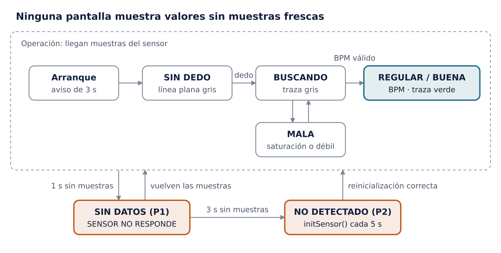

# Plan de pruebas – Etapa 10 (Etapa9.ino)

> Plan de pruebas aprobado (revisión 19). Es un **plan**: el estado real de ejecución está en [resultados-pruebas.md](resultados-pruebas.md). Corrección aplicada al publicar: número de líneas de `Etapa9.ino` (4098 → 4112, inconsistencia I1, autorizada el 2026-10-09).

## Alcance e inventario

El plan cubre las **154 funciones** de `Etapa9.ino` y 17 flujos de extremo a extremo. **152 funciones pueden ejecutarse en PC** con simuladores; `setup()` y `loop()` se prueban en PC y en el ESP32. El firmware no se modifica: las pruebas compilan una copia preprocesada en una carpeta aparte.

- **Línea base:** `Etapa9.ino`, MD5 `4d70eb1aef89be2d7ab61ec6d39b9f12`, 4112 líneas (versión con la corrección P3).
- **Regla:** ninguna prueba edita el `.ino`. Antes de cada corrida se verifica el MD5; si cambia, la corrida se detiene.
- **Fuera de alcance:** exactitud clínica. Sin oxímetro de referencia, la SpO₂ solo se prueba contra la curva implementada, no contra un valor real.

| Categoría | Qué incluye | Funciones | Entorno |
| --- | --- | --- | --- |
| 1 · Puras o deterministas | Cálculo, textos y formato; algunas leen variables globales que la prueba fija antes | 45 | PC |
| 2a · Adquisición, I2C y FIFO | Lectura de registros, FIFO, ventanas, frecuencia de muestreo | 14 | PC con simulador del MAX30102 |
| 2b · Procesamiento PPG | DC, filtros, reinicios y estabilización | 5 | PC |
| 2c · BPM | Detector de picos, intervalos y estados | 10 | PC |
| 2d · R y SpO₂ | R por latido, calidad, mediana y curva | 15 | PC |
| 2e · Interfaz TFT y gráfica | Campos, redibujado parcial, gráfica de barrido | 25 | PC con TFT simulada (framebuffer) |
| 2f · P1–P4 y comandos | Vigilancia, recuperación, arranque, tramos, Serial | 12 | PC con simulador |
| 2g · Pruebas guiadas | Máquinas de estados `t`, `v`, `u`, `w` | 26 | PC con guion de dedo simulado |
| 4 · Extremo a extremo | `setup()` y `loop()` | 2 | PC y hardware |

La categoría 3 no agrupa funciones sino **propiedades físicas** que ninguna simulación demuestra (señal óptica real, temporización I2C/SPI, alimentación, imagen de la pantalla); se detalla en su propia sección y repite en hardware parte de las pruebas de las categorías 2 y 4.

## Estrategia y entornos

Las pruebas usan tres niveles: **unitarias en PC**, **integración en PC con simuladores** y **validación en hardware**. El arnés de PC ya existe en forma de prototipo: es el que se usó para comparar la Etapa 9 contra la 6.2 línea por línea.

**Cómo se compila sin tocar el firmware**

1. Se copia `Etapa9.ino` a `tests/firmware/` y se verifica su MD5.
2. `arduino-cli` (el mismo preprocesador del IDE) genera `Etapa9.ino.cpp` con los prototipos automáticos.
3. Cada archivo de prueba incluye ese `.cpp` en la misma unidad de compilación, así accede a funciones y variables globales sin cambiar el código.
4. Un marco de pruebas para C++ (Unity o doctest) ejecuta los casos y genera un informe JUnit XML.
5. Un `run_tests.sh` hace todo lo anterior y falla si algún caso falla o si el MD5 no coincide.

| Doble de prueba | Sustituye a | Qué permite controlar | Estado |
| --- | --- | --- | --- |
| Núcleo simulado (`Arduino.h`) | `millis()`, `micros()`, `delay()`, `Serial`, `ESP` | Reloj virtual en µs; Serial capturado a texto; memoria libre fija | Existe |
| Simulador del MAX30102 (`Wire.h`) | Bus I2C y sensor | Señal PPG con BPM, ruido, amplitud y R configurables; FIFO de 32 con OVF; dedo puesto o retirado; bus cortado (`DEAD_FROM`/`DEAD_TO`); pérdida de configuración (`POR_AT`) | Existe |
| TFT simulada (`Adafruit_ST7735`/`GFX`) | Pantalla ST7735 | Framebuffer de 128×160 con la fuente real de GFX; tiempo de dibujo calibrado con la Etapa 7.2; volcado a imagen | Existe |
| `SPI.h` simulado | Bus SPI | Registro de `SPI.begin()` y sus pines | Existe |
| `esp_system.h` simulado | Motivo de reinicio | Cualquier motivo, incluido brownout | Existe |
| Inyector de Serial | Monitor Serie | Guion de comandos con tiempos (`SCRIPT`, `TIMES`) | Existe |
| Referencia en Python (SciPy) | — | Respuesta en frecuencia esperada de los filtros y valores de la curva de SpO₂ | Por crear |

**Tipos de verificación**

- **Afirmaciones directas** sobre valores devueltos y variables globales (categorías 1 y 2).
- **Registros dorados:** la salida Serial de un escenario fijo se compara con una referencia aprobada; cualquier cambio de procesamiento aparece como diferencia.
- **Instantáneas de pantalla:** el framebuffer se compara píxel a píxel en zonas definidas (campo BPM, campo SpO₂, calidad, pie, gráfica).
- **Equivalencia con la 6.2:** con la misma señal simulada, la salida de procesamiento de la Etapa 9 debe coincidir con la de la Etapa 6.2 validada.

**Límite del arnés:** compila con el g++ del PC, no con el compilador Xtensa del ESP32; las diferencias de precisión de `float` y la temporización real solo se ven en hardware (categoría 3).

## Categoría 1 · Funciones puras o deterministas (45, PC)

Estas 45 funciones se prueban en PC con afirmaciones directas, sin simuladores de hardware; las que leen variables globales las fijan en el `setUp()` de cada caso. Valores esperados calculados con las constantes reales del código (fs = 100 muestras/s).

| Función · propósito | Entradas → salida | Casos: normal · límite · error | Resultado esperado | Automatización · entorno |
| --- | --- | --- | --- | --- |
| `correlationFromSums` · correlación de Pearson RED-IR | n y 5 sumas → r | N: R = 2·I + 3 con 100 muestras · L: n = 1; señal constante (varianza 0) · E: n = 0; sumas que dan varianza negativa | 1.000; −1.000 si R = −I; 0 cuando n < 2 o varianza ≤ 0 | Unitaria · PC |
| `hrParabolicOffset` · vertice del pico entre muestras | (a, b, c) → desplazamiento en \[−0.5, 0.5\] | N: (1,3,2); (2,3,1); (1,2,1) · L: (2,2,2) denominador 0; (0,1,1.9) fuera de rango · E: (1,1,5) no es máximo | +0.1667; −0.1667; 0; 0; recortado a +0.5; 0 | Unitaria · PC |
| `spMedianOf` · mediana | arreglo, n → mediana | N: \[3,1,2\]; \[4,1,3,2\] · L: n = 1; n = 64; n = 65 · E: n = 0 | 2; 2.5; el elemento; usa solo los 64 primeros; 0. El arreglo de entrada no se modifica | Unitaria · PC |
| `spCvOf` · coeficiente de variación muestral | arreglo, n → CV | N: \[1,2,3\] · L: n = 2; valores iguales · E: n < 2; media ≤ 0 | 0.5; 0 en los casos límite y de error. Nota: `subCvPP` devuelve 99 con media ≤ 0; se documenta la diferencia | Unitaria · PC |
| `oxSpo2FromR` · curva R → SpO₂ | R → −45.060·R² + 30.354·R + 94.845 | N: R = 0.428; 0.5 · L: 0.337 (vértice); 0.34; 1.15 · E: R = 0 | 99.58; 98.76; 99.96; 99.96; 70.16; 94.85 (±0.01, contra Python) | Unitaria · PC |
| `hrStateText` · texto del estado BPM | 0, 1, 2 → texto | N: los 3 estados · E: 99 | SIN SENAL, ESTABILIZANDO, BPM VALIDO; 99 → SIN SENAL | Unitaria · PC |
| `oxStateText` · texto del estado SpO₂ | 0–4 → texto | N: los 5 estados · E: −1 y 7 | 5 textos distintos; fuera de rango → SIN SENAL | Unitaria · PC |
| `calidadTexto` · palabra de calidad | CAL\_\* → texto | N: las 5 categorías · E: −1 y 9 | BUENA, REGULAR, MALA, SIN DEDO, BUSCANDO; todas ≤ 8 caracteres; fuera de rango → BUSCANDO | Unitaria · PC |
| `calidadColor` · color de calidad | CAL\_\* → RGB565 | N: las 5 · E: fuera de rango | verde, amarillo, naranja, gris claro, gris claro; fuera de rango → gris | Unitaria · PC |
| `modoTexto` · texto del pie | MODO\_\* → texto | N: 1, 2, 3 · E: 0 y 9 | ESTIM. EXPERIMENTAL; SENSOR NO DETECTADO; SENSOR NO RESPONDE; otro → ESTIM. EXPERIMENTAL; todos ≤ 21 caracteres | Unitaria · PC |
| `campoNombre` · nombre en el diagnóstico | 0–3 → texto | N: 4 campos · E: 7 | 7 caracteres cada uno; fuera de rango → "Pie    " | Unitaria · PC |
| `uiTextoCentrado` · centrar en campo fijo | búfer, ancho, texto → cadena | N: ("BUENA", 8) · L: texto de 8; ""; ancho 21 · E: texto más largo que el ancho | " BUENA  "; igual; 8 espacios; centrado; truncado al ancho, sin escribir más allá de `out[ancho]` (verificado con byte centinela) | Unitaria · PC |
| `formatSpo2Key` · texto visible de SpO₂ | búfer, tamaño, clave → cadena | N: 985; 1000 · L: 0; 5 · E: −1; búfer de 6 bytes; `SPO2_DECIMALS = 0` (compilación alterna) | " 98.5"; "100.0"; "  0.0"; "  0.5"; " --.-"; sin desborde; " 98" y " --" | Unitaria · PC |
| `uiSpo2FieldX` · x del campo SpO₂ | `SPO2_DECIMALS` → px | N: decimales 1 · L: decimales 0 | 4; 40. El campo termina antes del "%" en x = 98 | Unitaria · PC |
| `uiPctX` · x del "%" | — → px | N: ambos modos | 98 | Unitaria · PC |
| `resetReasonText` · motivo de reinicio | código → texto | N: POWERON, EXT, SW, PANIC · L: los 3 watchdog; BROWNOUT · E: código desconocido | encendido, reset externo, reinicio por software, error del programa; watchdog; CAIDA DE VOLTAJE; otro | Unitaria · PC |
| `arranqueTipoTexto` · tipo de inicialización | 0, 1, 2 → texto | N: los 3 · E: 5 | arranque, reintento, recuperacion P2; 5 → arranque | Unitaria · PC |
| `isLargeStep` · cambio brusco | canal, x y DC fijado → bool | N: DC 100 000, x 110 001 · L: x = 110 000 exacto; DC 20 000, x 25 001 · E: DC 0, x 4999 y 5001 | true; false (comparación estricta); true (límite mínimo 5000); false y true | Unitaria · PC |
| `filtersSettled` · filtros estables | `filtersPrimed`, `settleRemaining` → bool | N: (true, 0) · L: (true, 1) · E: (false, 0) | true; false; false | Unitaria · PC |
| `computeFilterCoefficients` · coeficientes DC, pasa-altas y pasa-bajas | constantes → 9 coeficientes y 2 alfas | N: respuesta en frecuencia · L: alfas · E: estabilidad | Pasa-altas −3.01 dB ±0.1 en 0.5 Hz y 0 en 0 Hz; pasa-bajas −3.01 dB en 5 Hz y 1 en 0 Hz; `dcAlpha` = 0.009950; `dcAlphaFast` = 0.095163; polos dentro del círculo unitario. Contra SciPy | Unitaria con referencia Python · PC |
| `hrComputeConstants` · caída de la envolvente | constantes → `hrEnvDecay` | N: cálculo | e^(−1/200) = 0.995012 | Unitaria · PC |
| `highPass` · biquad pasa-altas | canal, x y estado → y | N: escalón; seno de 1.2 Hz · L: canales 0 y 1 independientes; estado en cero · E: x = 262 143 sostenido | Escalón → tiende a 0; seno pasa con ganancia ≈ 1; un canal no altera al otro; sin NaN ni infinito. Contra `scipy.signal.lfilter` (±1e-4 relativo) | Unitaria con referencia Python · PC |
| `lowPass` · biquad pasa-bajas | canal, x y estado → y | N: escalón; seno de 1.2 Hz y de 15 Hz · L y E: como `highPass` | Escalón → 1; 1.2 Hz ganancia ≈ 1; 15 Hz atenuado (contra SciPy) | Unitaria con referencia Python · PC |
| `hrMeanInterval` · intervalo medio | historial fijado → ms | N: \[800, 1000, 1200\] · L: 1 valor; 8 valores (búfer lleno) · E: vacío | 1000; el valor; media de 8; 0 | Unitaria · PC |
| `hrMedianInterval` · mediana de intervalos | historial → ms | N: \[800, 1000, 1200\] · L: 8 valores (par) · E: vacío | 1000; promedio de los 2 centrales; 0 | Unitaria · PC |
| `hrComputeCv` · CV de intervalos | historial → CV | N: \[800, 1000, 1200\] · L: 1 valor · E: vacío | 0.2; 0; 0 | Unitaria · PC |
| `hrStableBpm` · BPM estable | historial → BPM | N: media 1000 ms; 500 ms · E: vacío | 60.0; 120.0; 0 | Unitaria · PC |
| `hrRefractorySamples` · periodo refractario | historial, fs → muestras | N: sin historial; media 1000 ms; 1500 ms · L: fs 95 y 105 | 30; 60; 90; proporcional a fs | Unitaria · PC |
| `hrTimeoutSamples` · tiempo de espera sin pulsos | historial, fs → muestras | N: sin historial; media 1000 ms; 1500 ms · L: fs 95 y 105 | 300; 300 (gana el mínimo de 3 s); 375; proporcional a fs | Unitaria · PC |
| `hrValleyBefore` · valle del ciclo | búfer de PPG, índices → mínimo | N: búfer con valle conocido · L: ventana máxima de 159 muestras; inicio posterior al pico (tras reinicio); envoltura circular en 160 · E: historial vacío | El valle exacto; valor del propio pico si el inicio queda después; resultado igual a través de la envoltura; usa la ventana completa | Unitaria · PC |
| `spMedianR` · mediana del R histórico | `spR`, `spRCount` → R | N: 8 valores · E: 0 valores | Igual a `spMedianOf`; 0 | Unitaria · PC |
| `spCvR` · CV del R histórico | `spR`, `spRCount` → CV | N: 8 valores · E: 1 valor | Igual a `spCvOf`; 0 | Unitaria · PC |
| `testMeanDc` · DC medio del bloque | bloque k, canal → cuentas | N: sumas fijadas, k = 0, 1, 2 · E: `tCount` = 0 | suma / cuenta; 0 | Unitaria · PC |
| `testMeanRaw` · señal cruda media | bloque, canal → cuentas | N y E: como `testMeanDc` | suma / cuenta; 0 | Unitaria · PC |
| `testAcRms` · AC RMS del bloque | bloque, canal → cuentas | N: Σx² fijada · E: `tAcCount` = 0 | √(Σx² / n); 0 | Unitaria · PC |
| `subMeanPP` · media pico a pico | subventanas → cuentas | N: \[100, 120, 80\] · L: 12 subventanas · E: 0 subventanas | 100; media de 12; 0 | Unitaria · PC |
| `subMinPP` · mínimo pico a pico | subventanas → cuentas | N: \[100, 120, 80\] · E: 0 | 80; 0 | Unitaria · PC |
| `subCvPP` · CV pico a pico | subventanas → CV | N: \[100, 120, 80\] · L: 1 subventana · E: media ≤ 0 | 0.2; 0; 99 | Unitaria · PC |
| `activeTestBlock` · bloque activo de la prueba `t` | `testPhase` → bloque | N: fases de medición · E: fases de espera e IDLE | 0, 1, 2; −1 | Unitaria · PC |
| `anyTestRunning` · hay prueba en curso | 4 fases → bool | N y L: las 16 combinaciones IDLE / no IDLE | true si alguna no está en IDLE; false solo con las 4 en IDLE | Unitaria · PC |
| `calidadDesdeEstados` · tabla de calidad | `sensorReady`, DC IR, `hrState`, `oxState` → CAL\_\* | N: las 6 filas validadas · L: DC IR = 50 000 y 49 999; las 60 combinaciones · E: sensor no listo | Tabla de la Etapa 7.3; 50 000 = hay dedo (≥); 49 999 = SIN DEDO; sensor no listo → BUSCANDO | Unitaria por tabla · PC |
| `oxQualityFailReason` · primer criterio de calidad que falla | `spLast*` → texto | N: cada criterio fallando solo · L: PI 0.19/0.20; AC RED 49/50; correlación 0.79/0.80; R\_diff 0.16/0.15; ΔDC 0.06/0.05 · E: todos cumplen | El texto de ese criterio, en el orden del código; en el valor límite no falla; "calidad baja" | Unitaria por tabla · PC |
| `uiPpgValorAPixel` · valor → fila de la gráfica | valor, centro, rango → fila | N: valor = centro · L: centro ± rango/2 · E: fuera de escala | 127; 108 y 145; recortado a 108 o 145 | Unitaria · PC |
| `ppgMuestra` · PPG desde el búfer | índice → −`spAcIr[i % 256]` | N: índice 10 · L: 255, 256 y 2³²−1 · E: — | Signo invertido; 256 cae en la casilla 0; el desborde de 32 bits no rompe la casilla (256 divide 2³²) | Unitaria · PC |
| `ppgMuestraOk` · validez de la muestra | índice → `spOk[i % 256]` | N y L: como `ppgMuestra` | Devuelve la bandera de esa casilla | Unitaria · PC |

## Categoría 2a · Adquisición, I2C y FIFO (14, PC con simulador)

La ruta de adquisición se prueba en PC contra el simulador del MAX30102, que reproduce el FIFO de 32 muestras, el contador de desbordamiento de 5 bits y las fallas de bus. `initSensor` y `readFifo` se repiten después en hardware (categoría 3), porque el simulador no reproduce la temporización ni la electrónica reales.

| Función · propósito | Entradas → salida / efectos | Casos: normal · límite · error | Resultado esperado | Automatización · entorno |
| --- | --- | --- | --- | --- |
| `readRegisters` · lectura I2C de registros consecutivos | registro, búfer, n → bool y bytes | N: 3 bytes desde 0x04 · L: n = 1; n = 60 (ráfaga máxima) · E: `endTransmission` ≠ 0; `requestFrom` devuelve menos bytes; `available()` = 0 a mitad | true y bytes correctos; false en cada error, sin incrementar `i2cErrors` (lo hace quien llama) | Unitaria con mock de `Wire` configurable por caso · PC |
| `readRegister` · un registro | registro, referencia → bool | N: PART\_ID · E: bus cortado | true y 0x15; false | Unitaria · PC |
| `printRegisterCheck` · comparar un registro con lo esperado | nombre, registro, esperado → línea Serial | N: coincide · L: difiere · E: lectura falla | "\[ OK \]"; "DIFERENTE"; "ERROR DE LECTURA" | Unitaria con Serial capturado · PC |
| `printConfiguration` · configuración y registros leídos | — → texto | N: tras `initSensor` | FIFO\_CONFIG 0x50, MODE\_CONFIG 0x03, SPO2\_CONFIG 0x2F, LED1 y LED2 = 0x1F, todos "OK" | Registro dorado · PC; repetir en HW |
| `initSensor` · iniciar I2C y configurar el sensor | — → bool | N: sensor presente · L: segunda llamada con el bus ya iniciado (ruta de P2) · E: sensor ausente; PART\_ID distinto de 0x15 | true y registros configurados; true otra vez, misma configuración; false y mensaje "\[FALLA\]" en ambos errores | Integración con simulador · PC; **obligatoria en HW** |
| `setLedCurrent` · corriente de los LED | valor → escritura I2C | N: 0x1F · L: 0x05 y 0x50 (límites de `+`/`-`) · E: bus cortado | LED1 = LED2 = valor y `ledCurrent` actualizado; mensaje con mA = valor × 0.2 | Integración con simulador · PC; efecto óptico en HW |
| `readFifo` · vaciar el FIFO | punteros, datos → n.º de muestras o −1 | N: 1 muestra pendiente · L: punteros que dan la vuelta (WR 2, RD 30 → 4); 25 pendientes (ráfagas 10/10/5); desbordamiento con OVF = 14; OVF saturado en 31; valor 0xFFFFFF · E: falla al leer punteros; falla en la segunda ráfaga | 1; 4; 25 en 3 lecturas; `pending` = 32, `overflowEvents` +1, `lostSamples` +14; +31 (mínimo); 262 143 (máscara de 18 bits); −1 e `i2cErrors` +1; devuelve lo ya leído e `i2cErrors` +1, el resto queda en el FIFO. Orden RED antes que IR; `processSample` se llama una vez por muestra y en orden | Integración con simulador · PC; **obligatoria en HW** |
| `processSample` · tubería por muestra | RED, IR, nivel del FIFO → llamadas en cadena | N: una muestra · L: modos de salida `k`, `p` (1 de cada 10), `g`, `x` · E: modo desconocido | `sampleIndex` +1 y la cadena en orden: PPG → ventana → prueba → búfer de R → BPM → pruebas → estado SpO₂; formato exacto de cada modo; modo desconocido no imprime | Integración con espías de orden · PC |
| `resetFsMeasurement` · reiniciar la medición de fs | ms → referencias | N: tras 10 s de datos | Referencias = valores actuales de muestras y pérdidas | Unitaria · PC |
| `updateFsMeasurement` · medir fs | ms → `measuredFs` | N: 500 muestras en 5 s · L: 4.99 s; con 20 pérdidas incluidas · E: fs fuera de 95–105 (90 y 110) | 100.0; sin cambio; cuenta producidas = procesadas + perdidas; fs fuera de rango se ignora | Unitaria · PC |
| `resetWindow` · iniciar ventana de 1 s | ms → acumuladores | N: tras una ventana | Acumuladores en cero; referencias de pérdidas, errores y reinicios actualizadas | Unitaria · PC |
| `accumulateWindow` · estadísticas de la ventana | RED, IR, nivel → acumuladores | N: 100 muestras normales · L: valor 260 000 (saturación, ≥); valor 0; nivel del FIFO 32 · E: muestras durante la estabilización | Cuenta, mínimo y máximo de AC; saturadas +1; ceros +1; FIFO máximo 32; las de estabilización no entran en las estadísticas de AC | Unitaria · PC |
| `printChannelLine` · línea por canal | nombre, canal → texto | N: ventana llena · E: ventana sin muestras de AC | DC, AC p-p, AC RMS y AC/DC con formato fijo; sin división entre cero | Registro dorado · PC |
| `reportWindow` · reporte cada segundo | ms → texto | N: modo `d` · L: 999 ms (no imprime) y 1000 ms; modos `b`, `o`, `s` · E: alertas: pérdidas, errores I2C, saturación, ceros, reinicios | Una línea por segundo en el formato del modo; banderas PERDIDAS, ERR\_I2C, SATURACION, CEROS y REINICIO\_FILTROS con su conteo; la ventana se reinicia | Registro dorado con escenarios · PC |

## Categoría 2b · Procesamiento PPG (5, PC)

El procesamiento se prueba en PC con secuencias de muestras sintéticas (escalones, senos y ruido) inyectadas directamente en `processPPG`; la referencia es la misma cadena DC + biquads calculada en Python. El punto crítico es la estabilización de 200 muestras: 100 de DC rápido con filtros detenidos y 100 de calentamiento.

| Función · propósito | Entradas → salida / efectos | Casos: normal · límite · error | Resultado esperado | Automatización · entorno |
| --- | --- | --- | --- | --- |
| `resetFilters` · reinicio de filtros | RED, IR → estado | N: tras operar con estado no nulo | DC = la muestra; estados de los biquads en 0; `lastAc` = 0; `settleRemaining` = 200; `filtersPrimed` = true | Unitaria · PC |
| `registerAutoReset` · registrar reinicio automático | — → contadores | N: una llamada | `autoResets` +1; guarda el DC IR previo; clasificación pendiente | Unitaria · PC |
| `classifyPendingReset` · clasificar al terminar la estabilización | DC antes y después → contadores | N: DC 1500 → 110 000 (dedo colocado) · L: 110 000 → 1500 (retirado); DC antes y después = 50 000 exacto · E: sin clasificación pendiente | `fingerResets` +1; `fingerResets` +1; `artifactResets` +1 (misma condición); sin cambios | Unitaria · PC |
| `processPPG` · DC, filtros y reinicios por muestra | RED, IR → `lastDc`, `lastAc`, `resetThisSample` | N: primera muestra; seno de 1.2 Hz sobre DC de 100 000 en operación normal; DC en escalón pequeño (llega al 63 % en 100 muestras, τ = 1 s) · L: muestra 100 y 101 de la estabilización (cambio de fase); escalón grande durante la estabilización; fin de la estabilización en la muestra 200 · E: escalón de +20 % en operación; reinicio manual (`filtersPrimed` = false, comando `r`) | Primera muestra: reinicio y `resetThisSample` = true; AC igual a la referencia Python (±1e-3 relativo); fase 1 con AC = 0 y DC rápido (τ = 0.1 s); fase 2 con filtros activos; sin reinicio dentro de la estabilización (periodo refractario); clasificación al terminar; escalón → reinicio automático y nueva estabilización de 200 muestras | Unitaria con vectores sintéticos y referencia Python · PC |
| `printFilterConfiguration` · imprimir la configuración | coeficientes → texto | N: tras `computeFilterCoefficients` | Coeficientes con 6 decimales iguales a los calculados; τ, fc y umbrales correctos | Registro dorado · PC |

**Propiedad global a verificar:** para cualquier secuencia sin escalones grandes, la cadena es lineal e invariante en el tiempo; dos señales sumadas producen la suma de sus salidas (prueba de superposición con tolerancia de redondeo de `float`).

## Categoría 2c · Detección de pulsos y BPM (10, PC)

El detector se prueba en PC con PPG sintéticas de ritmo conocido (40 a 180 BPM, con muesca dicrótica, ruido y latidos faltantes o extra) y con el simulador completo. Criterio central: con señal limpia de 72 BPM, el BPM estable queda en 72 ±1 y el estado llega a BPM VALIDO en menos de 15 s desde que se coloca el dedo.

| Función · propósito | Entradas → salida / efectos | Casos: normal · límite · error | Resultado esperado | Automatización · entorno |
| --- | --- | --- | --- | --- |
| `hrClearHistory` · borrar historial de intervalos | — → estado | N: con 8 intervalos | Historial, posición, CV y consecutivos en 0; envolvente y contadores acumulados intactos | Unitaria · PC |
| `hrResetDetector` · reinicio completo del detector | — → estado | N: en operación | Envolvente, umbral y muestras previas en 0; calentamiento = 150; búfer de valles vacío; sin pico pendiente; contadores acumulados intactos | Unitaria · PC |
| `hrEvaluateInterval` · aceptar o rechazar un intervalo | ms → historial y contadores | N: 1000 ms con historial de 1000 · L: 333 y 334 ms (180 BPM); 1500 y 1501 ms (40 BPM); desviación de 30 % exacto y de 31 %; 9.º intervalo con historial lleno · E: 3 rechazos seguidos | Aceptado; 333 rechazado (fuera de 40-180) y 334 aceptado; 1500 aceptado y 1501 rechazado; 30 % aceptado (comparación estricta) y 31 % rechazado como largo o corto; el 9.º reemplaza al más antiguo; al 3.er rechazo se borra el historial. Siempre avisa a `bpmTestOnInterval` | Unitaria por tabla · PC |
| `hrUpdateState` · transición de estado BPM | consecutivos, historial, CV → `hrState` | N: 5 aceptados con CV 0.05 · L: 4 aceptados; CV 0.20 y 0.21 · E: desde VALIDO, 2 rechazos seguidos; historial insuficiente | VALIDO; sigue ESTABILIZANDO; 0.20 permite VALIDO y 0.21 no; vuelve a ESTABILIZANDO con motivo «intervalos inconsistentes» | Unitaria por tabla · PC |
| `hrCommitPulse` · confirmar un pulso | tiempo del pico (muestras) → intervalo, R | N: segundo pulso a 100 muestras del primero · L: primer pulso (sin anterior); pico con fracción de muestra · E: — | 1000 ms evaluado, estado actualizado y `spo2OnBeat` llamado con la bandera de aceptación; el primero solo guarda el tiempo; el valle siguiente empieza en la muestra posterior al pico | Unitaria con espías · PC |
| `hrSetNoSignal` · marcar SIN SEÑAL | motivo → estado | N: «sin dedo» | `hrState` = SIN SEÑAL y `hrReason` = el motivo | Unitaria · PC |
| `updateHeartRate` · detector por muestra | RED, IR y estado PPG → pulsos y estado | N: PPG de 40, 60, 72, 120 y 180 BPM; muesca dicrótica del 45 % · L: calentamiento de 150 muestras; envolvente justo en 30; pico dentro del periodo refractario; latido faltante; pico extra · E: sin dedo (DC IR < 50 000); saturación (≥ 260 000); muestras perdidas; filtros estabilizando; 3 s sin pulsos | BPM ±1 en cada ritmo; la muesca no se cuenta como pulso; estado «midiendo amplitud» durante el calentamiento; envolvente < 30 → «señal débil»; el pico refractario no se cuenta; latido faltante → intervalo largo rechazado; pico extra → intervalo corto rechazado; sin dedo → reinicio y SIN SEÑAL; saturación → SIN SEÑAL durante 100 muestras; pérdidas → reinicio del detector; estabilizando → ESTABILIZANDO; sin pulsos → `hrTimeouts` +1 e historial borrado | Integración con vectores sintéticos y con el simulador · PC |
| `hrPrintPulseLine` · línea por pulso (modo `b`) | último pulso → texto | N: aceptado · L: primer pulso · E: rechazado | Formato con intervalo, BPM instantáneo y estado; motivo de rechazo cuando aplica | Registro dorado · PC |
| `printHeartRateConfiguration` · parámetros del detector | constantes → texto | N: arranque | Umbrales 40–180 BPM, 30 %, 8 intervalos, 5 consecutivos, fs medida | Registro dorado · PC |
| `printHeartRateSecond` · resumen por segundo (modo `b`) | ms, pérdidas, saturadas → texto | N: BPM válido · L: sin señal · E: con pérdidas y saturación | Estado, pulsos aceptados y rechazados, envolvente, CV y fs; conteos de pérdidas y saturación | Registro dorado · PC |

**Prueba de exactitud del detector:** barrido de 40 a 180 BPM en pasos de 10 y con 3 niveles de ruido (bajo, medio y alto, como el `NOISE` del simulador). El resultado es una matriz BPM real contra BPM detectado; criterio de aceptación: error ≤ 1 BPM con ruido bajo, y en ruido alto el estado no debe dar BPM VALIDO con un valor erróneo (mejor ESTABILIZANDO que un número falso).

## Categoría 2d · R por latido y SpO₂ experimental (15, PC)

R y SpO₂ se prueban en PC con latidos sintéticos cuyo R verdadero se conoce: si AC\_RED/DC\_RED = R · AC\_IR/DC\_IR, los tres estimadores (regresión, pico a pico y RMS) deben dar ese R. Esto verifica el **cálculo**, no la exactitud clínica: la curva de Maxim no está calibrada para este módulo.

| Función · propósito | Entradas → salida / efectos | Casos: normal · límite · error | Resultado esperado | Automatización · entorno |
| --- | --- | --- | --- | --- |
| `spo2StoreSample` · guardar AC y DC por muestra | RED, IR y estado PPG → búfer de 256 | N: muestra estable · L: muestra con reinicio de filtros; 257.ª muestra (envoltura) · E: saturada; SIN SEÑAL con historial de R | Casilla `sampleIndex % 256` escrita y válida; `spValidSinceIdx` = esa muestra; sobrescribe la casilla 1; inválida; historial de R borrado | Unitaria · PC |
| `spo2OnBeat` · calcular R del latido | inicio y fin del latido (muestras), aceptado → R y calidad | N: latido sintético con R = 0.5 y sin ruido; con ruido solo en RED · L: R = 0.34 y 1.15; latido de 3 muestras · E: intervalo no aceptado; inicio fuera del búfer (≥ 256 atrás); cruza un reinicio; una muestra no válida; DC = 0; RED e IR no correlacionados (R de regresión ≤ 0) | R de regresión, pico a pico y RMS = 0.500 (±0.005), correlación 1.00 y R\_diff 0; con ruido en RED la regresión no se sesga y el pico a pico sí; los límites se calculan igual; «latido demasiado corto»; en cada error se omite el latido con su motivo y no se agrega R | Unitaria con latidos sintéticos · PC |
| `spSkipBeat` · omitir un latido | motivo → contadores | N: cualquier motivo | Contador de omitidos +1; en modo `o` imprime el motivo; llama a `oxOnSkippedBeat` | Unitaria con espías · PC |
| `spClearHistory` · borrar historial de R | — → estado | N: con 8 valores | `spRCount` = `spRPos` = 0 | Unitaria · PC |
| `spPrintBeatLine` · línea por latido | último latido → texto | N: modo `o` · L: modo `c` (CSV) · E: otro modo | Formato con R, AC, DC, PI y correlación; fila CSV con 17 columnas; nada en otros modos | Registro dorado · PC |
| `printSpo2Configuration` · parámetros de R | constantes → texto | N: arranque | Umbrales PI 0.20 %, AC RED 50, correlación 0.80, R\_diff 0.15, ΔDC 0.05 | Registro dorado · PC |
| `printSpo2Second` · resumen de R por segundo | ms → texto | N: con historial · E: sin latidos | Mediana y CV del R de regresión; texto de «sin latidos» | Registro dorado · PC |
| `oxClearHistory` · borrar historial de SpO₂ | — → estado | N: con 8 R | Cuentas y medianas en 0 | Unitaria · PC |
| `oxRecompute` · mediana y CV de R válidos | historial → mediana, CV, PI, correlación | N: 8 valores · E: 0 valores | Igual a `spMedianOf` / `spCvOf`; todo en 0 | Unitaria · PC |
| `oxRegisterInvalid` · registrar latido no válido | motivo, fuera de rango → contadores | N: 1 inválido · L: 3.º consecutivo · E: — | Inválidos +1, consecutivos +1, motivo guardado; al 3.º se borra el historial pero se conserva la cuenta de consecutivos; avisa a la prueba `w` | Unitaria · PC |
| `oxOnBeat` · clasificar el latido para SpO₂ | estado BPM, calidad, R → historial | N: BPM válido, calidad correcta, R = 0.43 · L: R = 0.34 y 1.15 exactos; R = 0.339 y 1.151 · E: BPM no válido; calidad insuficiente | Agregado al historial, consecutivos en 0, hora del último válido; límites aceptados; fuera de rango como inválido con marca de rango; «BPM no válido»; motivo de calidad | Unitaria por tabla · PC |
| `oxOnSkippedBeat` · latido sin R | motivo → inválido | N: una llamada | Registrado como inválido sin marca de rango | Unitaria · PC |
| `oxUpdateState` · estado de SpO₂ | estado BPM, historial, tiempo → `oxState`, `oxSpo2` | N: 5 R válidos de 0.43 con BPM válido · L: 4 R válidos; 5000 ms y 5001 ms desde el último válido; CV 0.10 y 0.11; mediana 0.34 y 0.33 · E: SIN SEÑAL; BPM estabilizando; inválidos con menos de 5 válidos | VÁLIDA con 99.58 %; ESTABILIZANDO; 5000 ms sigue válida y 5001 da CALIDAD INSUFICIENTE; CV 0.10 válida y 0.11 no; mediana 0.34 válida y 0.33 FUERA DE RANGO (caso de caja blanca: solo se alcanza forzando el historial, porque solo entran R entre 0.34 y 1.15); SIN SEÑAL con historial borrado; ESTABILIZANDO; CALIDAD INSUFICIENTE o FUERA DE RANGO según el último. `oxSpo2` = 0 en todo estado que no sea VÁLIDA | Unitaria por tabla con reloj virtual · PC |
| `printSpo2ConversionConfiguration` · curva y criterios | constantes → texto | N: arranque | Coeficientes a, b, c, 8 R para la mediana, mínimo 5, CV 10 %, rango 0.34–1.15 | Registro dorado · PC |
| `printSpo2ConversionSecond` · resumen por segundo (modo `s`) | ms → texto | N: VÁLIDA · L: cada estado · E: SIN SEÑAL | SpO₂ con un decimal y «estimación experimental»; «---» y el motivo en los demás | Registro dorado · PC |

## Categoría 2e · Estados de calidad, interfaz TFT y gráfica PPG (25, PC con TFT simulada)

La interfaz se prueba en PC contra la TFT simulada: un framebuffer de 128×160 con la fuente real de Adafruit GFX que cuenta las llamadas a `fillScreen` y los píxeles enviados por SPI. Las verificaciones son de dos tipos: **contenido de zonas** (cada campo comparado píxel a píxel con una referencia) y **actualización parcial** (cuántos píxeles se tocan y cuándo). La tabla de calidad (`calidadDesdeEstados`) está en la categoría 1.

| Función · propósito | Entradas → salida / efectos | Casos: normal · límite · error | Resultado esperado | Automatización · entorno |
| --- | --- | --- | --- | --- |
| `uiDibujarEstatica` · parte fija de la pantalla | — → framebuffer | N: tras borrar la pantalla | Franja del encabezado en y 0–10 con «MONITOR PPG»; «FC», «BPM», «SpO2» y «SEÑAL» (con el glifo 0xA5); líneas en y = 47, 76, 105 y 148; nada fuera de 128×160 | Instantánea de zonas · PC |
| `uiDibujarCampoBPM` · campo BPM | clave → framebuffer | N: 72 · L: 100 tras 99 y 99 tras 100; 999 · E: −1 | « 72» verde, tamaño 4, en (16, 14); sin restos al cambiar de ancho (texto opaco); «999»; « --» gris | Instantánea · PC |
| `uiDibujarCampoSpO2` · campo SpO₂ y «%» | clave → framebuffer | N: 985 · L: 1000 tras 999 · E: −1 | « 98.5» y «%» cian; «100.0» sin restos; « --.-» y «%» grises | Instantánea · PC |
| `uiDibujarCampoCalidad` · palabra de calidad | CAL\_\* → framebuffer | N: las 5 categorías · L: REGULAR tras BUSCANDO (7 tras 8 caracteres) | Palabra centrada en 8 caracteres con su color; sin restos | Instantánea · PC |
| `uiDibujarPie` · pie | modo → framebuffer | N: los 3 modos | Texto centrado en 21 caracteres, amarillo, en y = 151 | Instantánea · PC |
| `uiDibujarCampo` · dibujar un campo y medirlo | campo, ms → dibujo y estadísticas | N: los 4 campos | Llama al dibujo correcto; clave visible = deseada; redibujados +1; último, máximo y suma (64 bits) de µs; máximo del tramo | Unitaria con espías · PC |
| `uiSolicitar` · pedir un valor visible | campo, clave → dibujo o pendiente | N: clave nueva tras 600 ms · L: misma clave; clave nueva a los 499 y 500 ms del último dibujo · E: — | Dibuja; no toca la TFT (0 píxeles); a 499 ms queda pendiente y a 500 dibuja; llamadas +1 siempre | Unitaria con reloj virtual · PC |
| `uiService` · dibujar pendientes | ms → dibujos | N: un pendiente vencido · L: varios campos pendientes · E: ninguno pendiente | Dibuja ese campo; dibuja cada uno a su tiempo; 0 llamadas a la TFT | Unitaria · PC |
| `actualizarBPM` · publicar BPM | BPM, válido → clave | N: (72, true) · L: (1200, true); (−5, true) · E: (72, false) | Clave 72; 999 (tope); −1; −1 | Unitaria · PC |
| `actualizarSpO2` · publicar SpO₂ | SpO₂, válido → clave | N: (98.54, true) y (98.56, true) · L: (100.4, true); (0.0, true) · E: (98.5, false); (−1, true) | 985 y 986; 1000 (tope en 100.0); 0; −1; −1. Con `SPO2_DECIMALS` = 0: 99 | Unitaria · PC |
| `actualizarCalidad` · publicar calidad | CAL\_\* → clave | N: BUENA · E: −1 y 7 | Clave BUENA; fuera de rango → BUSCANDO | Unitaria · PC |
| `uiSetModo` · elegir el pie | modo → clave | N: los 3 modos · E: 0 y 9 | Clave del modo; otro → EXPERIMENTAL | Unitaria · PC |
| `uiPantallaInicio` · aviso de 3 s | — → framebuffer | N: arranque | `fillScreen` +1; textos «PROTOTIPO ACADEMICO», «NO ES DISPOSITIVO MEDICO» en marco amarillo y «ESTIMACION EXPERIMENTAL» | Instantánea · PC |
| `uiRedibujarTodo` · redibujado completo | — → framebuffer | N: comando `f` · L: con la gráfica desactivada; con datos congelados | `fillScreen` +1; parte fija, 4 campos y marco de la gráfica; tiempo medido; mensaje GRAFICA DESACTIVADA o SIN DATOS DEL SENSOR | Instantánea · PC |
| `uiInit` · iniciar la pantalla | — → SPI, TFT y estado | N: arranque | `SPI.begin(18, 19, 23, −1)`; `initR(INITR_BLACKTAB)`; SPI a 16 MHz; rotación 0; aviso con reloj virtual +3 s; claves iniciales: «--», «--.-», BUSCANDO y pie | Integración con espías · PC; imagen en HW |
| `uiPpgReiniciarEscala` · reiniciar escala | — → estado | N: tras operar | Rango 1000, centro 0, provisional, columnas no válidas | Unitaria · PC |
| `uiPpgCortarLinea` · cortar la línea | — → estado | N: a mitad de una columna | Sin punto anterior; acumulador vacío; cortes +1 | Unitaria · PC |
| `uiPpgInit` · iniciar la gráfica | — → estado | N: arranque | Cursor en 0; escala reiniciada; índice = `sampleIndex`; cortes en 0 | Unitaria · PC |
| `uiPpgDibujarMarco` · borrar el área de la gráfica | — → framebuffer | N: activa · L: desactivada; datos congelados | Solo el área 0–127 × 107–146 en negro, el resto intacto; cursor en 0; texto GRAFICA DESACTIVADA o SIN DATOS DEL SENSOR | Instantánea · PC |
| `uiPpgActualizarEscala` · escala automática lenta | 50 columnas → rango y centro | N: escala provisional · L: rango objetivo 19 % y 21 % mayor; 19 % y 21 % menor; 9 y 10 columnas válidas · E: señal plana (rango < 40) | Se aplica directo; dentro de ±20 % no cambia; más del 20 % mayor se aplica de inmediato; más del 20 % menor reduce el 25 %; con 9 columnas no recalcula; rango mínimo 40 | Unitaria por tabla · PC |
| `uiPpgDibujarColumna` · una columna del barrido | valor, válida, modo → framebuffer | N: modo normal válido · L: x = 127 → 0; columna 25 (recalcula escala) · E: modo plano; modo normal con columna no válida | Borra la columna 4 posiciones adelante, dibuja el segmento verde entre el punto anterior y el actual; el cursor vuelve a 0; escala recalculada; plano → línea gris en el centro; no válida → gris | Instantánea y unitaria · PC |
| `uiPpgAgregarMuestra` · agrupar 4 muestras | valor, válida, modo → columna | N: 4 muestras válidas · L: 3 muestras (sin columna) · E: 1 de 4 no válida | Columna con el promedio; ninguna columna; columna marcada no válida | Unitaria · PC |
| `uiPpgConsumirMuestras` · leer muestras nuevas del búfer | `sampleIndex`, pérdidas, calidad → columnas | N: 4 muestras nuevas · L: 201 muestras de atraso; cambio SIN DEDO ↔ con dedo; ventana de 5 s de columnas/s · E: aumentaron las pérdidas; gráfica desactivada | Una columna; salto al final y «saltos del búfer» +1; corte y escala reiniciada; columnas/s ≈ fs/4; corte y escala reiniciada; solo sigue el índice, sin dibujar | Integración con el simulador · PC |
| `uiPpgAlternar` · comando `l` | — → estado y framebuffer | N: activar y desactivar | Cambia el estado; marco redibujado; índice y pérdidas al día; medición de columnas/s reiniciada | Unitaria · PC |
| `uiActualizarDesdeEstados` · publicar los estados reales | estados, `sensorReady`, datos congelados → 4 campos | N: BPM y SpO₂ válidos · L: llamadas a 249 y 250 ms · E: sensor no listo; datos congelados | BPM, SpO₂ y calidad correctos; evalúa solo cada 250 ms y siempre atiende pendientes; «--» y SENSOR NO DETECTADO; «--», BUSCANDO y SENSOR NO RESPONDE | Unitaria por tabla · PC |

**Propiedad global:** en 10 minutos simulados de operación normal (sin `f`), el contador de `fillScreen` no cambia y ningún campo se redibuja más de 2 veces por segundo.

## Categoría 2f · Vigilancia P1, recuperación P2, diagnóstico P3, tramos P4 y comandos (12, PC con simulador)

P1–P4 se prueban en PC con el reloj virtual y las fallas inyectables del simulador: bus cortado (`DEAD_FROM`/`DEAD_TO`), pérdida de configuración del sensor (`POR_AT`) y sensor ausente al encender. Los comandos se prueban con guiones de Serial (`SCRIPT`/`TIMES`) y registros dorados.

| Función · propósito | Entradas → salida / efectos | Casos: normal · límite · error | Resultado esperado | Automatización · entorno |
| --- | --- | --- | --- | --- |
| `integracionAntesDeLeer` · tiempos antes de leer (P3/P4) | ms → separación máxima | N: lecturas cada 10 ms · L: primera lectura tras inicializar (`lastFifoReadMs` = 0) · E: hueco de 110 ms (comando `f`) | Máximo 10 ms; no mide el primer hueco pero registra el tiempo de primera lectura de P3; máximos acumulado y de tramo = 110 | Unitaria con reloj virtual · PC |
| `integracionDespuesDeLeer` · registro tras leer (P3/P4) | muestras leídas → FIFO máximo y arranque | N: lectura correcta · L: primera lectura de un arranque, de un reintento y de una recuperación · E: lectura con error (−1) | Nivel máximo acumulado y del tramo; línea `[ARRANQUE]` una sola vez por inicialización con tipo, FIFO, pérdidas y desbordamientos, «setup tras init» solo en el arranque; el registro del arranque inicial se copia una vez; con −1 queda pendiente | Unitaria y registro dorado · PC |
| `arranqueRegistrarInit` · registrar una inicialización (P3) | ms, tipo → estado | N: arranque · L: reintento; recuperación · E: — | Inicializaciones +1; copia de pérdidas y desbordamientos; primera lectura pendiente; solo el tipo arranque marca el registro inicial | Unitaria · PC |
| `arranqueFinSetup` · medir el fin de `setup()` (P3) | ms → tiempo de setup | N: arranque con primera lectura pendiente · L: llamada después de un reintento · E: sin inicialización (sensor ausente) | Mide init → fin de setup; no mide; no mide | Unitaria · PC |
| `vigilanciaReiniciar` · reiniciar el plazo de P1/P2 | ms → referencias | N: fin de `setup()` | Última muestra = `sampleIndex` actual y su hora | Unitaria · PC |
| `vigilanciaMuestras` · vigilancia de muestras (P1) y disparo de P2 | ms, `sampleIndex` → estado, pantalla, `sensorReady` | N: muestras llegando · L: 999 y 1000 ms sin muestras; 2999 y 3000 ms; un bloqueo de 110 ms del `loop()` · E: bus cortado 2 s; bus cortado 10 s; pérdida de configuración | Nada; a 1000 ms entra en datos congelados (eventos +1, aviso Serial y gráfica); a 3000 ms `sensorReady` = false y recuperaciones iniciadas +1; el bloqueo no dispara (se lee antes de evaluar); 2 s → solo P1 y se repone sola; 10 s → P1, P2 y reintentos; configuración perdida → recuperación en ≈ 3 s. Tiempo sin datos acumulado correcto | Integración con fallas inyectadas · PC; repetir en HW (SDA) |
| `vigilanciaSensorRecuperado` · inicialización exitosa en el reintento | ms → contadores | N: tras P2 · L: sensor ausente al encender y detectado después · E: — | Recuperaciones exitosas +1 y tipo «recuperación P2»; tipo «reintento» sin contar como recuperación; plazo de vigilancia reiniciado | Integración · PC |
| `tramoReiniciar` · iniciar un tramo (P4) | ms → referencias del tramo | N: comando `z` · L: dos `z` seguidos | Referencias = acumulados actuales; máximos del tramo en 0; **los acumulados no cambian** | Unitaria · PC |
| `printIntegracion` · diagnóstico `y` | estado global → texto | N: operación normal · L: datos congelados; sensor no listo; arranque pendiente; después de 2 recuperaciones · E: sumas de 64 bits cerca del límite de 32 bits | Todas las secciones; pérdidas separadas en arranque y operación con suma = total; estado SIN DATOS o SENSOR NO LISTO; PENDIENTE; el arranque inicial se conserva; promedios correctos sin desbordar | Registro dorado y afirmaciones sobre el texto · PC |
| `printHelp` · ayuda `h` | — → texto | N: `h` | Lista los 22 comandos, incluidos `y`, `f`, `l` y `z` | Registro dorado · PC |
| `setOutputMode` · cambiar el modo de salida | carácter → `outputMode` | N: cada modo (b, k, o, c, s, d, p, g, x) · L: con cada una de las 4 pruebas en curso · E: — | Modo aplicado y mensaje; durante una prueba se guarda y se aplica al terminar; `c` y `x` imprimen su cabecera CSV; `g` y `k` sin texto extra | Unitaria por tabla · PC |
| `handleSerialCommands` · intérprete de comandos | caracteres del Serial → acciones | N: los 22 comandos en minúscula y mayúscula · L: espacios, CR y LF; `+` en 0x50 y `-` en 0x05; varios comandos en una sola lectura · E: `v`, `u`, `w` o `t` con una prueba en curso; `r`, `+`, `-`, `f` o `l` durante una prueba; carácter desconocido | Cada comando ejecuta su acción; los separadores se ignoran; mensajes de límite (16 mA y 1 mA); se procesan en orden; «Ya hay una prueba en curso» y los mensajes de bloqueo; «Comando no reconocido» | Registro dorado con guiones · PC |

## Categoría 2g · Máquinas de pruebas guiadas (26, PC con guion de dedo)

Las 4 pruebas guiadas son máquinas de estados por tiempo; se prueban en PC sincronizando el guion de dedo del simulador (`FIN`/`FOUT`) con sus fases, en un escenario que debe aprobar y en varios que deben fallar. Cada prueba tiene la misma secuencia de 6 fases: espera, medición sin dedo, colocación, dedo quieto, espera de retiro y medición final.

| Prueba (comando) | Duración de las fases (s) | Total | Criterios principales que se verifican |
| --- | --- | --- | --- |
| Señal PPG (`t`) | 3 · 5 · 5 · 10 · 3 · 5 | 31 s | Los 11 criterios de la Etapa 4.1 (DC con y sin dedo, AC, correlación RED-IR, estabilidad entre subventanas, pérdidas y saturación) |
| BPM (`v`) | 3 · 5 · 10 · 20 · 3 · 5 | 46 s | Envolvente ≥ 50; BPM VALIDO en ≤ 15 s; ≥ 10 intervalos aceptados; rechazos ≤ 20 %; válido ≥ 80 % del tiempo quieto; SIN SEÑAL en ≤ 3 s al retirar y ≥ 95 % del tiempo sin dedo |
| R (`u`) | 3 · 5 · 10 · 30 · 3 · 5 | 56 s | ≥ 15 latidos con R; CV de R ≤ 10 %; calidad por latido |
| SpO₂ (`w`) | 3 · 5 · 10 · 30 · 3 · 5 | 56 s | ≥ 15 latidos válidos; SpO₂ VÁLIDA en ≤ 20 s; válida ≥ 80 % del tiempo quieto; rango ≤ 3 puntos; media en 88–100 %; inválida en ≤ 3 s al retirar; concordancia con oxímetro NO EVALUADA |

**Escenarios por prueba:** (1) señal limpia → todos los criterios \[OK\]; (2) sin colocar el dedo; (3) dedo nunca retirado; (4) ruido alto; (5) saturación; (6) muestras perdidas durante la fase quieta. Del 2 al 6, el criterio correspondiente debe marcar \[FALLA\] y la sugerencia debe coincidir con la causa.

| Función · propósito | Entradas → salida / efectos | Casos: normal · límite · error | Resultado esperado | Automatización · entorno |
| --- | --- | --- | --- | --- |
| `resetTestAccumulators` · limpiar acumuladores de `t` | — → estado | N: inicio de la prueba | Sumas, cuentas y subventanas en 0 | Unitaria · PC |
| `discardSubwindow` · descartar subventana con reinicio | — → estado | N: reinicio de filtros a mitad | Subventana descartada y contada | Unitaria · PC |
| `accumulateTest` · acumular por bloque | RED, IR → sumas | N: en cada fase de medición · L: 12.ª subventana (máximo) · E: fase de espera | Suma en el bloque 0, 1 o 2; no pasa de 12 subventanas; nada en espera | Unitaria · PC |
| `printTestResult` · línea de criterio | nombre, ok → texto | N: true y false | «\[ OK \]» y «\[FALLA\]» con el nombre | Unitaria · PC |
| `startPpgTest` · iniciar `t` | ms → fase y modo | N: sin otra prueba | Fase de espera; modo de salida guardado y cambiado a `d`; referencias de pérdidas y reinicios | Unitaria · PC |
| `updatePpgTest` · avanzar `t` | ms → fases | N: las 6 fases · L: transición exacta en cada límite de tiempo | Cada fase dura su tiempo (± una vuelta del `loop()`); al final llama a `finishPpgTest` | Integración con reloj virtual · PC |
| `finishPpgTest` · informe de `t` | acumuladores → informe | N: escenario 1 · E: escenarios 2–6 | 11 criterios \[OK\]; \[FALLA\] en el criterio de cada escenario; modo de salida restaurado | Registro dorado por escenario · PC |
| `bpmTestReset` · limpiar contadores de `v` | — → estado | N: inicio | Contadores de todas las fases en 0 | Unitaria · PC |
| `bpmTestOnPulse` · contar pulso | — → contadores | N: en fase quieta · E: sin prueba en curso | +1 en la fase; nada fuera de la prueba | Unitaria · PC |
| `bpmTestOnInterval` · contar intervalo | ms, aceptado → contadores | N: aceptado y rechazado · L: intervalos sucesivos | Aceptados y rechazados; mínimo, máximo y variación sucesiva | Unitaria · PC |
| `bpmTestOnSample` · contar por muestra | ms, RED, IR → contadores | N: cada fase · L: primer BPM VALIDO; primer SIN SEÑAL tras retirar | Muestras, válidas, sin señal y saturadas por fase; tiempos hasta válido y hasta sin señal | Unitaria · PC |
| `startBpmTest` / `updateBpmTest` / `finishBpmTest` · prueba `v` | ms → fases e informe | N: escenario 1 · L: límites de 15 s y 3 s · E: escenarios 2–6 | Igual que `t`, con los criterios de `v` | Integración y registro dorado · PC |
| `rtReset` · limpiar `u` | — → estado | N: inicio | Latidos registrados en 0 | Unitaria · PC |
| `rtOnBeat` · registrar R del latido | último R → arreglos | N: fase quieta con BPM válido · L: latido 64 (máximo) · E: BPM no válido; fuera de la fase | Guarda R, R\_pp, R\_diff, PI, AC y correlación; no pasa de 64; ignora | Unitaria · PC |
| `rtOnSample` · contar por muestra | RED, IR → contadores | N: cada fase | Contadores por fase | Unitaria · PC |
| `startRTest` / `updateRTest` / `finishRTest` · prueba `u` | ms → fases e informe | N: escenario 1 · L: 15 latidos exactos; CV 10 % · E: escenarios 2–6 | Igual que `t`, con los criterios de `u`; modo de salida restaurado | Integración y registro dorado · PC |
| `stReset` · limpiar `w` | — → estado | N: inicio | Contadores y arreglos de `w` en 0 | Unitaria · PC |
| `stOnBeat` · registrar latido válido o inválido | válido → arreglos | N: válido en fase quieta · L: latido 64 · E: fuera de la fase | Guarda R, PI, correlación y SpO₂, o cuenta un inválido; tope 64; ignora | Unitaria · PC |
| `stOnSample` · contar por muestra | ms, RED, IR → contadores | N: cada fase · L: primera SpO₂ VÁLIDA; primera inválida tras retirar | Tiempos hasta válida y hasta inválida; mínimo y máximo de SpO₂ | Unitaria · PC |
| `startSpo2Test` / `updateSpo2Test` / `finishSpo2Test` · prueba `w` | ms → fases e informe | N: escenario 1 · L: 15 latidos; rango de 3 puntos; límites de 20 s y 3 s · E: escenarios 2–6 | Igual que `t`, con los criterios de `w`; estado de SpO₂ reiniciado al iniciar (corrección de la Etapa 6.2) | Integración y registro dorado · PC; repetir en HW |

Las funciones que comparten fila (`start*`, `update*` y `finish*` de cada prueba) se prueban por separado con los mismos escenarios: el inicio fija la fase y el modo, la actualización cambia de fase en el tiempo exacto y el final produce el informe y restaura el modo.

## Categoría 3 · Pruebas que requieren ESP32, MAX30102 y TFT

Estas 14 pruebas solo pueden hacerse con el hardware: verifican propiedades físicas que el arnés de PC no modela (luz y tejido, electrónica del bus, tiempos reales, imagen de la pantalla y compilador Xtensa). Se ejecutan manualmente y su evidencia es la salida de `y`, los informes de las pruebas guiadas y fotos o video de la pantalla.

| ID | Qué se verifica (funciones) | Por qué no basta el PC | Procedimiento | Criterio de aceptación |
| --- | --- | --- | --- | --- |
| H0 | Compilación con el núcleo real (todas) | El arnés usa g++ del PC y librerías de pantalla simuladas | Arduino IDE con Arduino-ESP32 3.3.x y las librerías reales; anotar memoria de programa y global | Compila sin errores; memoria anotada en el informe |
| H1 | Configuración del sensor (`initSensor`, `printConfiguration`) | El simulador acepta cualquier escritura | Encender y enviar `i` | PART\_ID 0x15; FIFO\_CONFIG 0x50, MODE 0x03, SPO2 0x2F, LED 0x1F, todos OK |
| H2 | Adquisición sin pérdidas (`readFifo`, `loop`) | Tiempo y electrónica del bus reales | `z`, 30 min con dedo, `y` cada 10 min | Errores I2C 0; pérdidas y desbordamientos de operación 0; fs 98–102; separación ≤ 35 ms; FIFO ≤ 4 |
| H3 | Señal óptica real (`processPPG`) | La señal simulada es sintética | Modo `k` en el Serial Plotter; `d` con y sin dedo | Pulso visible; DC IR ≥ 50 000 con dedo y < 50 000 sin dedo; PI típico entre 0.5 y 2 % |
| H4 | Corriente de LED (`setLedCurrent`) | El efecto óptico no se simula | `+` y `-` con dedo, observando `d` | El DC sube y baja con la corriente; mensajes de límite en 16 mA y 1 mA |
| H5 | BPM real (`updateHeartRate`) | La exactitud depende de la señal real | Prueba `v` y conteo manual del pulso radial durante 60 s | `v` aprobada; diferencia con el conteo manual ≤ 5 BPM (referencia informal, no clínica) |
| H6 | SpO₂ experimental (`spo2OnBeat`, `oxUpdateState`) | Depende de la luz y del tejido | Prueba `w` tres veces | Todos los criterios automáticos \[OK\]; concordancia NO EVALUADA si no hay oxímetro de referencia |
| H7 | Imagen de la pantalla (funciones `ui*`) | El framebuffer no muestra color real, parpadeo ni contraste | Fotos o video de cada estado de calidad | Distribución B correcta; Ñ visible; sin parpadeo; aviso de 3 s al encender |
| H8 | Barrido de la gráfica (`uiPpg*`) | Velocidad real de dibujo | Cronómetro y conteo de picos por pantalla | 5.1 ± 0.3 s por pantalla; picos por pantalla ≈ BPM × 5.13 / 60 |
| H9 | Interacción SPI–I2C | Acoplamiento eléctrico real (antecedente de la Etapa 7.3) | 10 min con la gráfica activa y 10 min desactivada (`l`), `z` y `y` en cada tramo | Sin diferencia en errores I2C ni en pérdidas |
| H10 | Vigilancia y recuperación (`vigilanciaMuestras`, P2) | Falla física del bus | Desconectar solo el SDA 2 s y luego 10 s | 2 s: «--» en ≤ 1.5 s y reposición sola. 10 s: «SENSOR NO RESPONDE», luego «SENSOR NO DETECTADO», recuperación P2 y 1/1 en `y`, sin reinicio del ESP32 |
| H11 | Arranque (P3) | Tiempo real de impresión de la configuración | 5 encendidos seguidos, anotando la línea `[ARRANQUE]` y `y` | Origen de las 14 pérdidas históricas identificado (arranque u operación) |
| H12 | Alimentación y memoria (`resetReasonText`, `ESP.getMinFreeHeap`) | No hay brownout ni montones reales en PC | 60 min con dedo intermitente | Motivo del reinicio = encendido; memoria mínima estable (±1 KB) |
| H13 | Funcionamiento prolongado (`setup`, `loop`) | Deriva térmica, conexiones y estabilidad | 60 min continuos | Sin reinicios ni valores congelados; contadores de operación sin aumento |

La prueba H10 no simula la pérdida de alimentación del sensor; ese caso queda verificado solo en simulación (`POR_AT`) y así debe constar en el informe.

## Categoría 4 · Flujos de extremo a extremo

Los 17 flujos ejercitan `setup()` y `loop()` con todas las funciones a la vez, desde la muestra del sensor hasta la pantalla y el Monitor Serie. En PC se automatizan con el simulador (escenario, guion de dedo, fallas y comandos con tiempos) y se comparan con registros e instantáneas aprobados; los marcados con HW se repiten en el hardware.

Los flujos E1–E8 recorren los estados de operación y E9–E13 las fallas; al retirar el dedo, cualquier estado de operación vuelve a SIN DEDO.

| ID | Flujo | Estímulo | Resultado esperado | Entorno |
| --- | --- | --- | --- | --- |
| E1 | Arranque normal | Encender con el sensor conectado | Aviso de 3 s; pantalla con «--», «--.-» y SIN DEDO; línea `[ARRANQUE] init #1 (arranque)`; `fillScreen` usado 2 veces | PC y HW |
| E2 | Medición normal | Dedo quieto desde el segundo 10 | BUSCANDO con traza gris; BPM VALIDO en ≤ 15 s; SpO₂ VÁLIDA en ≤ 20 s; BUENA con traza verde; valores de la TFT = valores del modo `s` | PC y HW |
| E3 | Retiro del dedo | Retirar con medición válida | SIN DEDO, «--» y línea plana gris en ≤ 0.75 s; ningún valor congelado | PC y HW |
| E4 | Movimiento o presión | Escalón de DC del 20 % con el dedo puesto | Reinicio automático clasificado como artefacto; BPM vuelve a ESTABILIZANDO; ningún BPM válido falso | PC y HW |
| E5 | Saturación | Señal ≥ 260 000 (luz intensa o corriente alta) | MALA y «--» mientras dure, más 1 s de retención | PC y HW |
| E6 | Señal débil | Dedo apenas apoyado (amplitud baja) | MALA (señal débil) o BUSCANDO; nunca BUENA | PC y HW |
| E7 | SpO₂ sin calidad o fuera de rango | Ruido solo en RED o R fuera de 0.34–1.15 | REGULAR; BPM visible; SpO₂ «--.-» | PC |
| E8 | Ritmo irregular | Latidos faltantes y extra en la señal simulada | Intervalos rechazados con su motivo; el BPM puede alternar entre número y «--» (comportamiento validado) | PC |
| E9 | Corte breve del bus (< 1 s) | Bus cortado 0.5 s | Sin cambio visible; pérdidas de operación registradas si el corte supera 320 ms | PC |
| E10 | Corte de 1 a 3 s (P1) | Bus cortado 2 s | «--» y SENSOR NO RESPONDE en ≤ 1.5 s; reposición sola; 0 recuperaciones | PC y HW (SDA) |
| E11 | Corte mayor de 3 s (P1 + P2) | Bus cortado 10 s | P1 a 1 s; P2 a 3 s; SENSOR NO DETECTADO; reintentos fallidos; recuperación al volver el bus; 1/1 en `y` | PC y HW (SDA) |
| E12 | Pérdida de configuración del sensor | `POR_AT` a mitad de una medición | P1 a 1 s; P2 a 3 s; recuperación en ≈ 3 s sin reiniciar el ESP32; arranque inicial conservado en `y` | Solo PC |
| E13 | Sensor ausente al encender | Encender sin sensor y conectarlo después | SENSOR NO DETECTADO; reintento cada 5 s; al detectarlo, `init #1 (reintento)` y «sensor no detectado al encender» en `y` | PC |
| E14 | Pruebas guiadas completas | `t`, `v`, `u` y `w` con su guion de dedo | Todos los criterios \[OK\] con señal limpia; \[FALLA\] correcto en los escenarios con error | PC y HW |
| E15 | Sesión de comandos | Secuencia de los 22 comandos, con y sin prueba en curso | Cada acción y mensaje; bloqueos durante las pruebas; 0 falsas alarmas de P1 después de `f`, `i`, `l` y `z` | PC y HW |
| E16 | Funcionamiento prolongado | 24 h virtuales en PC; 60 min en HW, con dedo intermitente | Sin reinicios; contadores de operación sin aumento; memoria estable; columnas/s ≈ fs/4 durante todo el periodo | PC y HW |
| E17 | Equivalencia con la Etapa 6.2 | Misma señal simulada, prueba `w` | Salida de procesamiento idéntica línea por línea a la de la 6.2 validada (ya demostrado en las Etapas 7.3, 8.2 y 9) | PC |

## Trazabilidad, criterios de aceptación y siguientes pasos

La Etapa 10 de pruebas se da por superada cuando las 154 funciones tienen al menos un caso automatizado que pasa, los 17 flujos pasan en PC y las 14 pruebas de hardware cumplen su criterio, sin ningún cambio en `Etapa9.ino`.

| Área del sistema | Funciones | Flujos | Pruebas en HW |
| --- | --- | --- | --- |
| Adquisición, I2C y FIFO | Cat. 2a (14) | E1, E9, E16 | H0, H1, H2 |
| Procesamiento PPG | Cat. 1 (filtros) y 2b (5) | E2, E4 | H3, H4 |
| BPM | Cat. 1 (intervalos) y 2c (10) | E2, E8 | H5 |
| R y SpO₂ | Cat. 1 (curva, mediana) y 2d (15) | E2, E7, E17 | H6 |
| Estados de calidad | `calidadDesdeEstados`, `oxUpdateState`, `hrUpdateState` | E2–E7 | H7 |
| Interfaz TFT | Cat. 2e (15 funciones `ui*` y `actualizar*`) | E1–E3 | H7 |
| Gráfica PPG | Cat. 2e (9 funciones `uiPpg*`) y adaptador | E2, E3 | H8, H9 |
| Vigilancia P1 y recuperación P2 | `vigilancia*`, `uiActualizarDesdeEstados` | E10–E13 | H10 |
| Diagnóstico P3 y tramos P4 | `arranque*`, `integracion*`, `tramoReiniciar`, `printIntegracion` | E1, E12, E13, E16 | H11, H12 |
| Comandos seriales | `handleSerialCommands`, `setOutputMode`, `printHelp` | E15 | — |
| Pruebas guiadas | Cat. 2g (26) | E14 | H5, H6 |

**Criterios de aceptación**

1. MD5 de `Etapa9.ino` = `4d70eb1a…` antes y después de cada corrida.
2. 100 % de los casos de PC pasan. Cobertura de líneas medida con `gcov`: **objetivo ≥ 85 %, no requisito de aprobación**; cada línea no cubierta se justifica una por una (por ejemplo, código que solo se ejecuta en hardware). Solo pasa a ser requisito si el profesor fija explícitamente el 85 %.
3. Registros dorados e instantáneas sin diferencias contra la referencia aprobada.
4. Equivalencia E17 con la Etapa 6.2 sin diferencias en el procesamiento.
5. Pruebas H0–H13 cumplen su criterio y quedan documentadas con la salida de `y`, los informes y fotos o video.

**Hallazgos del análisis (sin cambios al código):**

- `spCvOf` devuelve 0 con media ≤ 0 y `subCvPP` devuelve 99 en el mismo caso; no afecta el uso actual (R siempre positivo) pero se documenta.
- El estado FUERA DE RANGO por mediana de R no es alcanzable con el flujo normal; solo se prueba forzando el historial.
- La pérdida de alimentación del sensor solo está verificada en simulación.

**Siguientes pasos**

- [ ] Crear `tests/` aparte del firmware con el arnés, los simuladores y `run_tests.sh`.
- [ ] Escribir las pruebas de la categoría 1 (las más rápidas) y la referencia de filtros y curva en Python.
- [ ] Escribir las categorías 2a–2g y los flujos E1–E17 en PC.
- [ ] Ejecutar H0–H13 en hardware y reunir la evidencia.
- [ ] Después: documentación técnica, presentación y manual de usuario.
