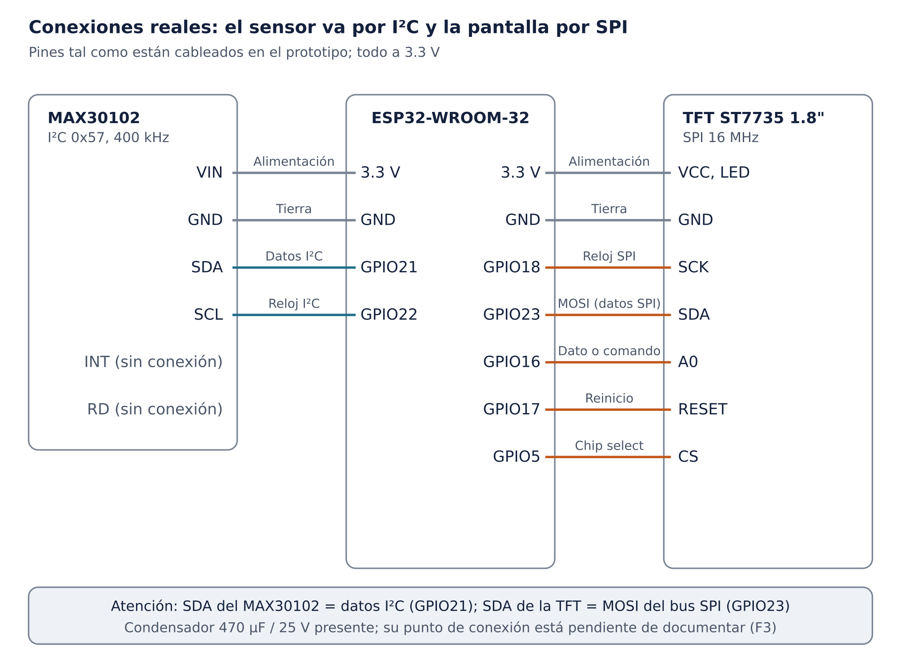

# Conexiones

> Versión documentada: `firmware/etapa9-validada/Etapa9/Etapa9.ino`, MD5 `4d70eb1aef89be2d7ab61ec6d39b9f12`. Exportado al repositorio el 2026-10-09.

> **Aclaración sobre “SDA”.** El pin SDA del MAX30102 es la línea de datos del bus **I²C** y va a GPIO21. El pin rotulado “SDA” en la TFT es en realidad **MOSI** del bus **SPI** y va a GPIO23. Son señales distintas que comparten nombre en la serigrafía.

| ESP32 GPIO | Dispositivo | Pin | Función | Constante en el firmware |
| --- | --- | --- | --- | --- |
| 3.3 V | MAX30102 | VIN | Alimentación del sensor | — |
| GND | MAX30102 | GND | Tierra | — |
| GPIO21 | MAX30102 | SDA | Datos I²C | `PIN_SDA` = 21 (L154) |
| GPIO22 | MAX30102 | SCL | Reloj I²C, 400 kHz | `PIN_SCL` = 22 (L155), `I2C_FREQ` (L156) |
| — | MAX30102 | INT | Sin conexión | — |
| — | MAX30102 | RD | Sin conexión | — |
| 3.3 V | TFT | VCC | Alimentación de la pantalla | — |
| GND | TFT | GND | Tierra | — |
| 3.3 V | TFT | LED | Retroiluminación | — |
| GPIO18 | TFT | SCK | Reloj SPI | `TFT_SCK` = 18 (L2819) |
| GPIO23 | TFT | SDA (MOSI) | Datos SPI hacia la pantalla | `TFT_MOSI` = 23 (L2820) |
| GPIO16 | TFT | A0 (DC) | Selección dato o comando | `TFT_DC` = 16 (L2822) |
| GPIO17 | TFT | RESET | Reinicio de la pantalla | `TFT_RST` = 17 (L2823) |
| GPIO5 | TFT | CS | Selección de chip | `TFT_CS` = 5 (L2824) |
| GPIO19 | — | (MISO) | Reservado por `SPI.begin`; no se conecta | `TFT_MISO_UNUSED` = 19 (L2821) |

La cabecera del firmware repite estas conexiones (L35–41). Coinciden con las que el autor declaró para el prototipo.

Detalle completo: capítulo 15 de la [documentación técnica](../docs/documentacion-tecnica.md).
